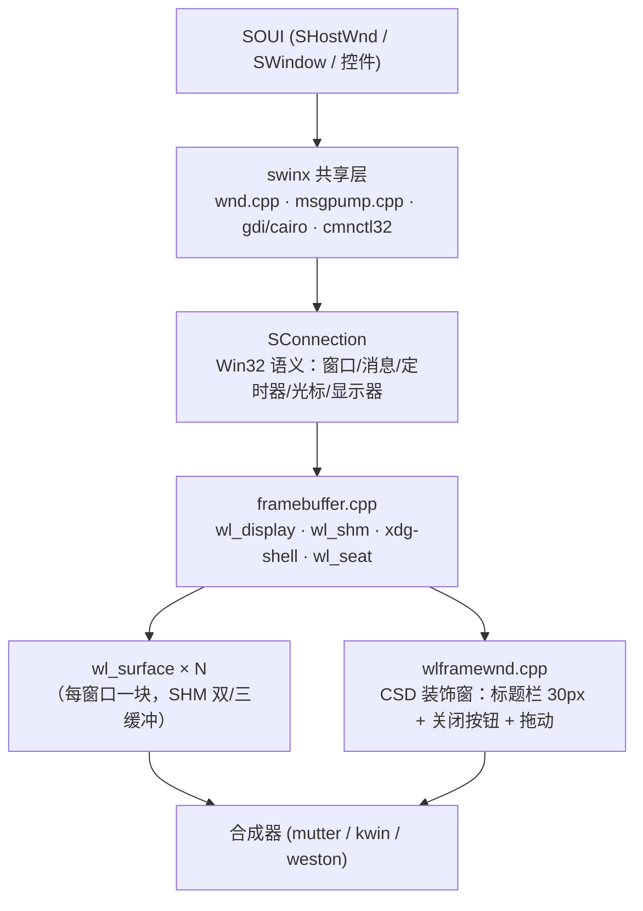

# swinx Linux Wayland 后端实现说明

> 适用范围：`swinx/src/platform/wayland/`（Linux 原生 Wayland 后端）
> 对照后端：`swinx/src/platform/linux/`（X11/XCB，行为不变）
> 关联文档：[swinx-Linux-Wayland适配可行性报告.md](swinx-Linux-Wayland适配可行性报告.md)（立项阶段的可行性分析与阶段规划）
> 最后更新：2026-11-23（第六轮：窗口图标 app_id + 每显示器 DPI/非整数缩放 + xdg-desktop-portal 文件对话框）

## 1. 结论与当前状态

Wayland 后端已经**可以在 GNOME/mutter 上正常跑 SOUI 应用**：`demos/demo` 的主界面、换肤对话框、模态 MessageBox、tooltip、菜单/下拉、中文输入（键盘直输）、窗口拖动与关闭全部可用；`demos/fun_test` 的 651 个桌面用例在同一台机器上全部通过。

它与 X11 后端是**编译期二选一**的互斥实现：同一份 `src/`（`wnd.cpp` / `msgpump.cpp` / `gdi` / `cmnctl32`）之上，`linux.cmake` 根据 `SWINX_LINUX_BACKEND` 只编一个后端目录，因此两个后端不会同时链接，也不需要在共享代码里加平台分支。

核心结论有两条，决定了后续所有取舍：

1. **xdg-shell 没有客户端窗口定位能力**。`xdg_toplevel` 只有尺寸 configure，没有 `set_position`；窗口落在哪里完全由合成器决定（mutter 的 `find_first_fit` 从工作区原点级联）。要"居中"只能靠合成器策略（`org.gnome.mutter center-new-windows`）或把窗口做成 `xdg_popup`。
2. **GNOME 强制客户端装饰（CSD）**。`xdg-decoration` 的 `SERVER_SIDE` 在 mutter 上会被回退成 `CLIENT_SIDE`，所以带 `WS_CAPTION` 的窗口必须由平台自己补一层装饰窗，等价于 X11 下窗口管理器的 reparent。

## 2. 架构



### 文件职责

| 文件 | 职责 |
|---|---|
| `SConnection.h/.cpp` | Win32 API 的 Wayland 语义实现：窗口注册表、消息泵、定时器、显示器枚举、光标、键盘布局、焦点、z 序、`GetDpi`、`MonitorFrom*` |
| `framebuffer.h/.cpp` | 协议层：`wl_display`/registry/`wl_shm`/`wl_subcompositor`/`wl_seat`/`wl_output`/`xdg_wm_base`；每窗口 surface + buffer 池 + frame callback；`xdg_popup` + positioner 定位；光标 surface |
| `wlframewnd.h/.cpp` | 客户端装饰窗：把内容窗包成 `wl_subsurface`，自绘标题栏，`WM_NCHITTEST` 映射到 `xdg_toplevel_move` |
| `SClipboard.h` + `SConnection.cpp` | 剪贴板：`SClipboard` 句柄存储 + `wl_data_source`/`wl_data_offer` 跨进程通道 + CF_*/mime 映射 |
| `imm.cpp` | 输入法：`zwp_text_input_v3` commit_string 已接（内联预编辑未做） |
| `ole2.cpp` / `SConnection.cpp` | OLE 拖放：登记 `IDropTarget`，`wl_data_device.start_drag` + offer→IDataObject 桥 + `IDropSource` 询价 |
| `dlghelper.cpp` | 文件对话框：`org.freedesktop.portal.FileChooser`（OpenFile/SaveFile/目录）；颜色/字体显式失败（portal 无对应接口） |
| `STrayIconMgr.cpp` | 系统托盘：StatusNotifierItem over D-Bus（见 3.11） |
| `atoms.cpp` / `utils.cpp` | 剪贴板格式名与少量工具函数 |

### 窗口角色映射

| Win32 形态 | Wayland 角色 | 位置由谁决定 |
|---|---|---|
| 普通顶层窗口（无 `WS_CAPTION`） | `xdg_toplevel`（surface 自己就是顶层） | 合成器 |
| `WS_CAPTION` 顶层窗口 / MessageBox / `SHostDialog` | 装饰窗是 `xdg_toplevel`，内容窗是 `wl_subsurface`（偏移 `0,30`） | 合成器（装饰窗） |
| 有 owner 的 `WS_POPUP`（tooltip、菜单、下拉、模态对话框） | 装饰窗（若有）是 `xdg_popup`，由 `xdg_positioner` 按 SOUI 算好的屏幕坐标摆放 | **客户端** |
| 无 owner 的 `WS_POPUP`（启动时第一个 MessageBox） | `xdg_toplevel` | 合成器 |
| `WS_CHILD` 控件 | `wl_subsurface` | 父窗口 |
| `HWND_MESSAGE` 消息窗 | 不创建 surface | — |

> 关键不变量：**role 为 TOPLEVEL 的窗口（含被装饰窗包着的内容窗不参与）`rc` 原点必须是 `(0,0)`**。否则 pointer 事件给的 surface 局部坐标会和 SOUI `OnNcHitTest` 使用的屏幕坐标错位，标题栏被误判成 `HTTOP`，表现为"拖动变拉伸、按钮点不动"。

## 3. 已实现功能

### 3.1 连接与协议

- `wl_display` 连接、registry 绑定、错误处理（协议错误时打日志并退出，不静默卡死）
- `wl_compositor`、`wl_shm`（memfd 优先，`shm_open` 回退）、`wl_subcompositor`、`wl_seat`、`wl_output`、`xdg_wm_base`、`wl_data_device_manager`（v3）
- 缺少 `libwayland-client` / `wayland-protocols` / `wayland-scanner` 时降级为"内存帧缓冲骨架"，库仍可编译链接

### 3.2 渲染与上屏

- 每窗口一个 `wl_surface` + 3 块 SHM buffer 轮转，cairo image surface 直接作为 GDI 后端
- 脏区（damage）增量提交：`needFull` 与 `dirty` 二选一，避免每帧整屏拷贝
- `wl_surface.frame` 回调节流：合成器未回帧时不连发 commit
- buffer `busy` 期间不覆盖内容，`wl_buffer.release` 后补交（等价 GTK 的 backfill）

### 3.3 窗口生命周期

- 创建/销毁/显示/隐藏；`xdg_toplevel.close` 转 `WM_CLOSE`；`WM_DESTROY` 时销毁 surface、popup、装饰窗
- **延迟 map**：`SHostWnd::Create()` 先用 0×0 建宿主窗，真尺寸随后由 `SetWindowPos` 写入；`SetWindowVisible` 对 toplevel 在 `w<8||h<8` 时推迟 map，避免合成器按 0×0 摆位
- 标题、`app_id`、`xdg_toplevel.set_parent`
- 活动窗口/前台窗口/焦点跟随（`SetActiveWindow` / `SetForegroundWindow` / 键盘 enter）

### 3.4 客户端装饰（CSD）

- 触发条件：`WS_CAPTION` 且非 `WS_CHILD`、非 `WS_EX_TOOLWINDOW`、非 `WS_EX_COMPOSITED`、非 `HWND_MESSAGE`
- 标题栏：96dpi 基准 30px，按 `GetDpiForWindow` 缩放；标题文字（居中等宽省略）、最小化/最大化/关闭三按钮（悬停/按下态）
- 标题区 `WM_NCHITTEST → HTCAPTION`，按下后 `xdg_toplevel_move` 拖动窗口
- 关闭按钮与合成器 close 一律 `PostMessage(内容窗, WM_CLOSE)`，应用自己的关闭流程不受影响
- 内容窗输入区内缩 6px：边缘指针事件落到装饰窗，`WM_NCHITTEST` 的 8 个 HTLEFT/HTTOP… 映射到 `xdg_toplevel_resize`；popup 不参与缩放
- 最大化/还原按钮读写 `xdg_toplevel` 状态；状态由合成器 configure 回告并缓存
- 内容窗的 `dwStyle` / `parent` / `rc` 完全不变，SOUI 的 NC 绘制与命中和 X11 语义一致

### 3.5 输入

- pointer：enter / leave / motion / button / axis（垂直+水平滚动）
- **leave/enter 合批**：mutter 在 subsurface 提交、栈序变化、输入区更新后会做 repick（先 `set_focus(NULL)` 再 `set_focus(同 surface)`）。同一批事件里同窗口的 leave 被丢弃，避免误清 `MK_LBUTTON`（拖动中断）、误发 `WM_MOUSELEAVE`（tooltip/hover 丢失）
- keyboard：keymap 事件、scancode→VK 映射、modifiers、按键重复由 SOUI 侧处理。scancode→VK 用**显式 evdev 表**（`wlScancodeToVk`）：evdev 码按 QWERTY 物理位置排布（KEY_Q=16/KEY_E=18/KEY_A=30/KEY_S=31/KEY_C=46/KEY_V=47），不能按字母表顺序连续推算，否则打字错位（`test`→`usbu`）、Ctrl+C/V 被映射成 `\`/`]` 而失效
- 键盘焦点跟随 toplevel（即装饰窗），事件先转投内容窗，再按 `GetFocus()` 投给真正的焦点控件（richedit 等子窗）；指针事件不转。注意 X11 直接把键盘消息发给 `m_hFocus`，Wayland 若只投给 surface 对应的宿主窗，richedit41 收不到 WM_KEYDOWN，其内部 Ctrl/Shift 标志不会置位，Ctrl+C/V 全部失效（靠 `GetAsyncKeyState` 的拖选不受影响）
- `WM_MOUSEWHEEL` / `WM_MOUSEHWHEEL`、`GetKeyState` / `GetAsyncKeyState`
- **双击（`WM_*DBLCLK`）必须客户端自己合成**：Win32 由系统按 `CS_DBLCLKS`（`WndObj::bAutoDblClick`）与双击时限把第二次按下改写成 DBLCLK；X11 在 `XCB_BUTTON_PRESS` 里用 `e->time` 比对 `m_tsPrevPress`。Wayland 两样都没有——`wl_pointer.button` 只报按下/抬起，照搬成 `WM_LBUTTONDOWN` 的话，richedit 双击选词、列表双击打开这类操作全部静默失效（不会报错，只是"点了没反应"）。现在 `pointer_button` 把协议里的 `time` 随事件回投（`SwinxWlEvent::time`），`SwinxWlEventThunk` 用 `SConnection::OnButtonPress()` 算同键间隔，命中 `GetDoubleClickTime()` 就把消息改成 `WM_LBUTTONDBLCLK`/`WM_RBUTTONDBLCLK`/`WM_MBUTTONDBLCLK`。时限默认 400ms（GTK 默认值），`SWINX_WL_DOUBLE_CLICK_MS` 可覆盖——X11 读根窗口的 `_NET_DOUBLE_CLICK_TIME`，Wayland 没有等价通道，只能给默认值 + 环境变量
- 双击判定用**协议时间戳**而不是本地时钟：消息泵积压会把两次独立点击在本地时钟下压成"相邻"，`wl_pointer` 的 `time` 始终是事件真实发生时刻（时间戳缺失时才退回 `GetTickCount`）
- `wl_pointer` 按钮状态同步到 `GetKeyState` / `GetAsyncKeyState` 的 `VK_LBUTTON` / `VK_RBUTTON` / `VK_MBUTTON`（MOTION/BUTTON/LEAVE 全量对账，对齐 X11 的 `onMouseEvent` 与 wasm 的 `SyncMouseButtonState`）；richedit41 拖动扩展选区依赖此路径

### 3.6 光标

- 每 seat 一块 cursor surface；`HCURSOR → ARGB`（`GetIconInfo` 取热点，预乘）→ `wl_pointer.set_cursor`
- 跨 surface（主窗 ↔ 对话框）必重新绑定；`busy` 时用"旧图案 + 旧热点"重新下发（两者同源，不会位移）
- 只有 `ShowCursor(FALSE)` 才发 `set_cursor(NULL)`（协议里 null = 隐藏光标）；无图案时不发请求，让合成器用默认光标

### 3.7 弹出窗口定位

- 有 owner 的 `WS_POPUP` 创窗期或 `SetParent` 时转 `xdg_popup`；`xdg_positioner` 的 anchor rect / gravity / constraint 按 SOUI 的屏幕坐标设置
- 父 surface 未就绪时登记到待转换表，下一帧重试（`tryPendingDialogParent`）
- 父窗是装饰窗时 anchor 加标题栏高度；popup 隐藏时销毁 `xdg_popup`（下次显示位置可能变）

### 3.8 显示器与系统信息（每显示器 DPI + 非整数缩放）

- **多显示器枚举**：每个 `wl_output` 映射成一个 `HMONITOR = (HWND)(index+1)`（index 0 为主屏）。
  `GetMonitorCount/GetMonitor/GetMonitorRect/MonitorFromPoint/MonitorFromRect` 都按真实输出
  矩形工作（`geometry.x/y` 已是逻辑坐标，`mode.w/h` 物理像素按倍率换算）。
- **非整数缩放**：`wp_fractional_scale_v1` 的 `preferred_scale`（120=1.0、150=1.25、180=1.5、
  240=2.0）是合成器对每 surface 倍率的权威回答（GNOME 在 125%/150% 下 `wl_output.scale`
  只能报 2，必须靠它拿真实倍率）。配合 `wp_viewporter.set_destination` 把按物理像素渲染的
  SHM buffer 映射回合成器逻辑坐标，1.25/1.5 倍下不再整体拉伸。
  协议缺失时退化为 `wl_output.scale` 整数倍（旧行为），构建与运行都不硬依赖。
  CMake 依次搜索 `wayland-protocols` 的 `stable/`、`staging/`、`unstable/` 三个目录下的
  `fractional-scale/fractional-scale-v1.xml`（1.31 及更早版本还在 `unstable/`）；三个都没有时
  配置期打印提示，`SWINX_HAVE_FRACTIONAL_SCALE` 不定义，相关字段退化为常驻空指针。
- **坐标换算**：SOUI 画布/buffer 用物理像素，合成器的 surface 局部坐标是逻辑像素。
  回投事件（pointer/configure/dnd/popup_configure）乘倍率；下发协议（damage/subsurface
  位置/输入区/positioner）除倍率。viewport 未生效（100% 缩放或协议缺失）时全是恒等变换。
- **DPI**：`GetDpiForWindow(hwnd)` 按窗口所在输出倍率回报 96 基准 DPI，并主动向上贴到
  SOUI 内置档位（100/125/150/200/250/300），避开 `SDpiHandler::NormalizeScale` 的向下
  取整把 150% 打回 125%。`SWINX_WL_SCALE=0` 一键关闭全部缩放（回到 96dpi + 无 viewport），
  便于 A/B 排查。
- 键盘布局 API 采用单布局语义（`GetKeyboardLayout` 恒返回基础布局，`NEXT`/`PREV` 原地不动）——Wayland 的 keymap 由合成器统一提供，客户端没有"布局列表"

### 3.9 消息泵与定时器

- `SConnection::waitWakeup(ms)` 把 **`wl_display` 的 fd 与消息队列的管道 fd 一起 `poll`**：任一可读立即唤醒，都没有才睡满 `ms`（`waitMsg` 的 10ms 切片）。`SMsgLoop` 主循环的 `MsgWaitForMultipleObjects(0, NULL, ..., QS_ALLINPUT)` 现在直接委托给 `waitMsg`，`nCount > 0` 的路径也走同一个等待，不再 `sched_yield()` 忙转（原来空闲时会把一个核烧满）
- **必须消费队列唤醒信号**：`m_hQueueEvt` 是 `CreateEventA(NULL, FALSE, ...)`（auto-reset），POSIX 上由 pipe 实现——每次 `SetEvent()` 往管道写 1 字节，读的一方是 `WaitForSingleObject()`（`EventOp::onWaitDone()` 会把积压字节一次读空）。此前主循环走 `waitMutliObjectAndMsg` 的 `sched_yield()` 忙转，**从不读这个管道**，而 `postMsg()` / 定时器每秒写数百次 ⇒ 攒到 pipe 容量（64KB）后 `_SynHandle::writeSignal()` 的 `write()` 直接阻塞，整个消息泵卡死。典型触发：切到别的系统放一会儿再回来，鼠标一动要投递 `WM_MOUSEMOVE`，正好撞上写满的管道（栈顶 `writeSignal ← SetEvent ← updateMsgQueue ← waitMutliObjectAndMsg`）。现在 `waitWakeup()` 和 `waitMsg()` 入口都会把它读空，管道不再只写不读
- `SetTimer` / `KillTimer`：按 ms 精度驱动，`TM_CARET` / `TM_FLASH` / `TM_HOVERDELAY` 与 X11 同样的语义
- 自定义消息、`SendMessage` 同步回复（`MsgReply`）、回调任务

### 3.10 剪贴板与拖放（跨进程）

- 发布：`setClipboardData` → `wl_data_source` + `wl_data_device.set_selection`；`wl_data_source.send` 分块供数
- 读取：本进程无副本时 `wl_data_offer.receive` + fd 事件泵同步读取（最长 3s），结果按 CF_* 缓存，selection 代次变化时失效
- mime 映射：`CF_TEXT`/`CF_UNICODETEXT` ↔ `text/plain;charset=utf-8`（同时发布 `UTF8_STRING`/`text/plain`，UTF-8 ↔ 平台 wchar_t 走 `tostring/towstring`）；注册格式 ↔ `application/x-swinx-format-<注册名>`；`CF_HDROP` ↔ `text/uri-list`
- 拖放：`RegisterDragDrop` 登记 `IDropTarget`；`enter/motion/drop` 事件用 `wl_data_offer` 构造 `IDataObject` 代理；`DoDragDrop` 用 `start_drag` + `IDropSource::QueryContinueDrag` 询价
- 已验证的调用方：re41 富文本复制粘贴、Scintilla `DoDragDrop`、SOUI `SHostWnd::EnableDragDrop`

实现要点（第三轮修复）：

- `OleSetClipboard` 必须当场把 `IDataObject` 的**每个 `TYMED_HGLOBAL` 格式**抽成 `HGLOBAL` 副本再统一发布一次 selection。Wayland 没有 X11 的延迟渲染，若只抽 `CF_UNICODETEXT`，对端请求别的 mime 时 `wl_data_source.send` 无字节可写，表现就是"复制没反应"。
- `OleGetClipboard` 必须先按 selection 代次失效本地缓存。X11 后端靠 `getSelectionOwner()` 判断 owner，Wayland 没有全局 owner 快照；漏掉这一步时别的进程抢走剪贴板后仍会返回旧的外部 `IDataObject`（粘出旧内容或空白）。
- `wl_data_source.send` 对 selection 的每个 mime 各回调一次（GTK 会先问 `UTF8_STRING` 再问 `text/plain`），分块缓冲必须按 mime 隔离，否则第二份数据会接着第一份的 offset 继续写。
- **read 回调的 EOF 状态不能被清空**：`data_source_send` 循环调用 `read()` 直到返回 0。若在读完最后一块时把 offset 清回 0，下一次调用会被误判成"新请求"重新装载数据，永远返回正数 → `send` 死循环（日志表现为 `source.send chunk ... bytes=N` 和 `readForSelection ... bytes=N` 无限交替）。现在读完保留 `pos==size` 作为 EOF；每次 `wl_data_source.send` 开始前由协议层以 `buf==NULL` 发一次 reset 信号，回调据此把 offset 归零，保证同一 mime 的再次请求从头重发。`clipSourceRead` / `dragSourceRead` 两个回调都遵守这一约定。
- CSD 场景下 `wl_data_device.enter` 给的 surface 可能是装饰窗（`xdg_toplevel`），而 SOUI 把 `IDropTarget` 登记在内容窗上；目标查找必须同时覆盖 `frame` 与 `frameContent`。
- **selection 自清竞态**：`setDataObject()` 复制时不能先走 `emptyClipboard()`（`SwinxWlSelectionClear()` 会发 `set_selection(NULL)`）。它与紧随其后的 `publishSelection()` 产生两个 selection 回告，`framebuffer.cpp` 的 `g.selectionAwaitOwn` 是一次性消费标志，乱序时会被反转成「别人抢走了剪贴板」，`syncSelection()` 随即清掉刚发布的 `m_data`/`m_doExClip`——表现就是「Ctrl+C 后 Ctrl+V 没反应」。第四轮改为就地释放旧对象/数据，不碰 selection。
- CF_HDROP 文件拖放：GTK/Nautilus 提供 `text/uri-list`（每行一个 `file://` URI），`SWaylandDropDataObject` 识别该 mime 并在 `GetData(CF_HDROP)` 时经 `clipUriListToHDrop()` 转成 ANSI/宽字符 `DROPFILES` 双 0 结尾表，`DragQueryFile` 沿用 posix 实现。与 X11 从 `XdndSelection`/CF_TEXT 手工包 `DROPFILES` 的做法对齐。
- **selection source 绝不能调用 `wl_data_source.set_actions()`**：mutter 的 `data_device_set_selection()` 检查 `meta_wayland_data_source_get_actions(source, NULL) != 0`，命中就直接 `wl_resource_post_error(WL_DATA_SOURCE_ERROR_INVALID_SOURCE, "cannot set drag-and-drop source as selection")`。这是 **fatal protocol error，合成器会断开整个客户端连接**（表现为 Ctrl+C 后主窗口直接退出），不是可忽略的警告。`set_actions` 只允许在 `SwinxWlStartDrag()` 的 drag source 上调用；`SwinxWlSelectionSet()` 只做 `create_data_source` + `offer`。
- **接收侧必须同时发 `wl_data_offer.accept(serial, mime)`**：mutter 的 `data_offer_finish()` 检查 `offer->accepted`，未 accept 就 `finish` 会发 fatal `WL_DATA_OFFER_ERROR_INVALID_FINISH`。GTK 3.24.48（`gdkdnd-wayland.c:256/262`、`gdkselection-wayland.c:1879`）是 accept + set_actions 两条都发；旧实现 v3+ 分支只发 `set_actions`、把 mime 强转 `(void)`，所以 `dnd enter` 有但永远等不到 `drop`，即使到了也会在 `finish` 时崩。现在 `SwinxWlDndOfferAccept()` 先挑一个 offer 实际提供的 mime（请求的不在列表里就退到第一个，文件拖放只有 `text/uri-list`），发 accept 后再 set_actions；`SwinxWlDndOfferFinish()` 对未 accept 的 offer 跳过 `finish`。

- **`SwinxWlStartDrag` 的 query 回调与 read 回调共用同一个 ctx**：两者都收到 `WlDragSourceCtx*`。`dragQuery()` 曾直接把它 cast 成 `IDropSource*` 并虚调用 `QueryContinueDrag`，实际把 `pdo`（`IDataObject` 的 vtable 指针）当成 drop source 的 vtable，跳进无关方法后立即崩溃。现在 ctx 内单独保存 `IDropSource *pds`，query 走 `c->pds`；同时把 `GetAsyncKeyState(VK_ESCAPE)` 作为 `fEscapePressed` 传入（MK_* 位不含 Esc，re41 的 `CDropSource` 靠它返回 `DRAGDROP_S_CANCEL`）。
- **拖文本给只接 `CF_HDROP` 的目标时必须做 X11 同款兜底**：X11 的
  `SDataObjectProxy::GetData()`（`linux/SClipboard.cpp:282-316`）在 `CF_HDROP` 不可用时
  会降级成 `CF_TEXT` 读字节，再用 ANSI `DROPFILES` 包一个"文件名"，所以 demo 的
  `CTestDropTarget1::Drop()`（只问 `CF_HDROP`）在 X11 下能把拖入文本插进编辑框。
  Wayland 的 `SWaylandDropDataObject::GetData()` 原先直接 `DV_E_FORMATETC`，表现为
  `GetData fmt=15` → `no mime matched`、数据不到目标。现在当 offer 无 `text/uri-list`
  而只有文本 mime 时走 `clipTextToHDrop()`，与 X11 语义一致；真正的 uri-list 仍走
  `clipUriListToHDrop()`。注意系统层只有宿主 HWND 注册一个 dispatcher，SWND 级目标
  在 SOUI 自己的 dispatch list 里，X11/Wayland 这条链路相同，不要误判成重复注册。

- **drop 期间读 offer 会让 `data_device.leave` 提前到达，offer 必须按引用计数销毁**：
  `Drop()` 里 `wl_data_offer.receive` 走 `read_offer_to_heap()`，其中嵌套
  `wl_display_dispatch()` 会先把合成器发来的 `leave` 处理掉。旧实现的
  `destroyPending` 只挡住「读取中销毁」，读取结束时仍会 `delete o`，随后
  `SwinxWlDndOfferFinish()` 又对同一指针 `wl_data_offer_destroy`（栈：
  `offer_destroy`→`dnd_offer_destroy`→`SwinxWlDndOfferFinish`→`onWlDndDrop`）。
  现在 `WlDataOffer::refs`：seat(dnd/selection) 与进行中的 read 各持一份，
  `offer_destroy` 每次只减一份；`leave` 若碰上 `reading` 则只清 target、
  保留 seat 那份给随后的 finish 释放。

- **`start_drag` 的 serial 必须是 pointer button press 的 serial**：默认参数不能取 `g.lastSerial`，它会被 enter/leave/modifiers 覆盖；拖放途中按修饰键再松鼠标时旧 serial 失效，mutter 会静默忽略 `start_drag`。现在 `SwinxWlStartDrag()` 优先取 `seat->pressSerial`（与 `xdg_toplevel_move` 同源），仅当它尚为 0 时才退回 `g.lastSerial`。
- **拖动期间的拖放光标反馈（对齐 X11 `SDragDrop::give_feedback()`）**：X11 在拖动时调 `IDropSource::GiveFeedback(effect)`，re41 的 `CDropSource` 恒返回 `DRAGDROP_S_USEDEFAULTCURSORS`，于是按 effect 选 `IDC_COPY/MOVE/LINK/NODROP` 并 `SetCursor()`，光标随目标接受的效果变化。Wayland 侧 `dragQuery()` 曾只调 `GiveFeedback(DROPEFFECT_COPY)` 就丢弃返回值、从不设光标，而 `wl_data_source.action`（合成器把目标 `set_actions` 与修饰键合成后的最终 action 回告源端，对应 X11 的 `XdndStatus` 回写 `*pdwEffect`）是空实现——所以拖动时光标始终是编辑框的 IBEAM。现在 `data_source_action` 把 action 位（none=0/copy=1/move=2/ask=4，**没有 link**）换算后写入 `seat->dragEffect`（ask 归 0，不映射成 `DROPEFFECT_LINK`），`SwinxWlDragEffect()` 只回 `COPY|MOVE|NONE` 供源侧读取；`dragQuery()` 按 X11 语义检查 `GiveFeedback` 返回值，若 `DRAGDROP_S_USEDEFAULTCURSORS` 且 effect 变化，就用 `wlCursorPixels(LoadCursor(NULL, IDC_*))` + `SwinxWlSetCursorImage()` 换拖动光标。拖动结束后 `SConnection::DoDragDrop()` 调 `applyWlCursor()` 按当前鼠标所在窗口重新解析光标，对齐 X11 窗口级光标随消息恢复的语义（Wayland 的光标 surface 是 seat 级，不会自然回弹）。
- **拖动时 `set_cursor` 必须显式 flush（2026-11-22 补）**：DnD grab 期间源端收不到 `wl_pointer.motion`，而 `libwayland` 只在 `wl_display_dispatch()` 入口内部 flush。旧循环把 `query()` 排在 `poll()` **之后**，轮询一路超时 ⇒ `dragQuery()` 排入的 `set_cursor`/`attach`/`commit` 整场拖放都滞留在客户端发送队列里，请求根本没到合成器，表现为「光标毫无变化、也没有任何反馈日志」。现在循环顺序固定为 `query()` → `wl_display_flush()` → `poll()`，并带 `break` 处理取消。
- **目标反馈要回告合成器**：`SwinxWlDndOfferSetEffect()` 把目标端 `DragEnter/DragOver` 的结论（`m_dndEffect`）用 `wl_data_offer.set_actions()` 回告（`onWlDndMotion` 里只在 effect 变化时发，避免每条 motion 刷协议请求）。合成器再经 `wl_data_source.action` 送回源端——这是 X11 `XdndStatus` 的等价通道。
- **drag icon 承载系统拖放光标位图**：GNOME 在提供 drag icon 时会把指针光标让给图标（DnD grab 期间 `wl_pointer.set_cursor` 被合成器忽略），只改 `set_cursor` 看不见。`SwinxWlStartDrag()` 建一张独立、无角色的 `wl_surface` 作为 icon（不能用 cursor surface 或窗口 surface，否则触发 `wl_surface.role` 协议错误），`dragQuery()` 把与 X11 `SetCursor` **同一份** `IDC_*` 位图经 `SwinxWlDragIconImage()` attach 上去，偏移 `-hotX,-hotY` 对齐热点。图标 buffer 必须多块轮转（8 个 slot）：合成器会把当前 buffer 一直持到拖动结束、`wl_buffer.release` 迟来，单块 buffer 会让后续状态只落在 pending 上，画面永远停在 `start_drag` 那一帧。起始画面用 copy 徽标占位。
- 诊断：`[wl-drag] start / icon image / feedback / offer finish / done` 全部受 `SWINX_WL_TRACE` 控制，默认不输出；排查时用 `SWINX_WL_TRACE=1 ./bin/demo 2>&1 | grep wl-drag`。其中 `start ... serial=` 用于确认本次确实走了 wayland 的 `start_drag`（serial 失效会被静默忽略），`feedback effect= cursor= icon=` 确认四态切换与图标是否真的换过 buffer。

### 3.10.1 输入法（text-input-v3）

- 构建：`linux.cmake` 在 wayland-protocols 存在 `unstable/text-input/text-input-unstable-v3.xml` 时用 wayland-scanner 生成客户端绑定并定义 `SWINX_HAVE_TEXT_INPUT_V3=1`；缺失时静默退化为纯键盘输入，不影响 xdg-shell 硬依赖
- 协议：`framebuffer.cpp` 在 registry 里绑定 `zwp_text_input_manager_v3`，每个 `wl_seat` 建一个 `zwp_text_input_v3`，收到 `commit_string` 暂存、`done` 时以 `SWINX_WL_EVT_IME_COMMIT` 回投 UTF-8（接收方负责 `free`）
- 消息：`SConnection::onWlImeCommit()` 仿 X11 `xim_commit_string()` 逐字符 post `WM_IME_CHAR` 到 `m_hFocus`，SOUI 容器再按焦点派给具体 SWND（richedit/edit）；`preedit_string` 暂未实现内联预编辑
- IMM：`wayland/imm.cpp` 不再是全空桩——`ImmCreateContext/GetContext/AssociateContext/ReleaseContext/DestroyContext` 做真实 HIMC 引用计数并挂到 `WndObj::hIMC`，`AssociateHIMC` 同步 `SwinxWlImeSetEnabled()`；组合窗/候选窗位置可读写，`ImmGetCompositionString*` 仍返回 0（无预编辑）
- 光标跟随：`SConnection::SetCaretPos()` 调 `SwinxWlImeSetCursorRect(x, y, 1, caretHeight)` 下发 `zwp_text_input_v3.set_cursor_rectangle`；`enter/leave` 时重新 enable/disable 并补发光标矩形。注意 `zwp_text_input_v3.commit` **不带 serial 参数**，`done` 的 serial 是累计 commit 次数。

拖动反馈（对齐 X11 `SDragDrop::give_feedback()`）：X11 的做法是在 `IDropSource::GiveFeedback` 返回 `DRAGDROP_S_USEDEFAULTCURSORS` 时按 effect `SetCursor(IDC_COPY/IDC_MOVE/IDC_LINK/IDC_NODROP)`。Wayland 这边同一条路径拿同一份 `HCURSOR` 位图，但同时喂给两个载体：

- `wl_pointer.set_cursor`：DnD grab 期间**合成器会忽略**，只在非 grab 场景（如刚按下、还没开始 drag）有效，保留是为了不依赖合成器实现细节。
- **drag icon**：`start_drag` 的 `icon` 参数是唯一真正可见的载体。`SwinxWlDragIconImage()` 把 `wlCursorPixels()` 取到的 ARGB 位图 attach 到 icon surface，用 `-hotX,-hotY` 的 attach 偏移把热点对准指针——画面上就是系统标准的拖动光标（箭头+加号 / MOVE / 链接 / 禁止符），与 X11 完全一致。
- **icon 必须多 buffer 轮转**：mutter 会把 drag icon 的 buffer 攥到拖动结束（它不是逐帧合成的窗口 surface），`wl_buffer.release` 迟迟不来，就地改像素 + pending 补画的方案永远画在旧图上（表现为"icon 一直是 start_drag 时那一帧"）。现在保留 8 个 slot，每次换状态 attach 一块**全新** buffer，旧图在 release 回调里回收，并靠 `memcmp` 去重避免无谓 commit。
- **目标反馈怎么到源端**：目标端 `DragEnter/DragOver` 算出的 effect 经 `wl_data_offer.set_actions()` 回告合成器，合成器再以 `wl_data_source.action` 送回源端（等价于 X11 `XdndStatus` 回写 `*pdwEffect`）。`effect==0` 时必须上报 `actions=0, preferred=0`——只写 `preferred=0` 会被合成器当成"没有首选"而在 copy/move 里挑一个，源端永远看不到"禁止放下"。
- **dnd_action 只有 none=0/copy=1/move=2/ask=4，没有 link**（link 是 X11 `XdndAction` 的概念）。所以源端 `wl_data_source.set_actions` 与目标端 `set_actions` 的掩码都只用 `copy|move`（3），`DROPEFFECT_LINK` 在 Wayland 侧降级成 copy。之前误把 4 当 link 扩进掩码，会把 ASK 也声明出去：目标端 preferred 写 4 时合成器就选中 ASK 并回告源端（拖动时显示"链接"光标），松手时 `finish` 被 mutter 判为 `WL_DATA_OFFER_ERROR_INVALID_OFFER` / `"offer finished with an invalid action"`（`data_offer_finish()` 明确拒绝 current action 为 NONE/ASK），**fatal，整条连接被杀**，表现为 `unknown object (0xFF000000)` + `wl_display` 进入 EINVAL、DoDragDrop 返回 CANCEL。
- **`finish` 的三个前置条件**（mutter `data_offer_finish()`）：`offer->accepted`（accept 过非空 mime）、`offer->action_sent`（合成器已用 `wl_data_offer.action` 回过一次选定 action）、且该 action 不是 NONE/ASK。`SwinxWlDndOfferFinish()` 因此只在 `accepted && offer->action != 0` 时发 `finish`；否则只发 `destroy`——mutter 在 `destroy_data_offer()` 里按 `drop_performed` 走 `cancel`，语义等于"这次放下没被接受"，不会断连。

### 3.11 其它

- **系统托盘（Shell_NotifyIcon）**：Wayland 无原生托盘协议，走 freedesktop/KDE 的
  `org.kde.StatusNotifierItem` over session D-Bus（`src/platform/wayland/STrayIconMgr.cpp`）：
  - 注册 `org.kde.StatusNotifierItem-<pid>-<n>` 服务 + `/StatusNotifierItem` 对象，向
    `org.kde.StatusNotifierWatcher.RegisterStatusNotifierItem` 报到；监听 watcher 的
    `NameOwnerChanged`，host 重启后自动重新报到。
  - HICON（cairo 预乘 BGRA）反预乘后转网络序 ARGB32，作为 `IconPixmap a(iiay)` 暴露；
    `szTip` 进 `ToolTip`。NIM_MODIFY 发 `NewIcon`/`NewToolTip` 信号让 host 重拉。
  - `Activate`/`SecondaryActivate`→`WM_LBUTTONDOWN`、`ContextMenu`→`WM_RBUTTONDOWN`、
    `Scroll`→`WM_MOUSEWHEEL`，经 `uCallbackMessage` 回投 SOUI；点击坐标写入
    `SetCursorPos` 缓存，右键菜单的 `GetCursorPos` 因此拿到托盘位置。应用登记了菜单
    provider 时 `ContextMenu` 不再回投（菜单由面板绘制），`Activate`/中键仍回投
    `WM_LBUTTONDOWN` 表示"切窗"。
  - **GNOME appindicator 的点击语义与 X11 不同**（已查其 `indicatorStatusIcon.js`）：
    左键单击等一个 `doubleClickTime` 后切 Shell 菜单、不调 `Activate`；左键双击才调
    `Activate`；右键立即切 Shell 菜单、**不调 `ContextMenu`**；中键调 `SecondaryActivate`。
    且它要求 `Menu` 属性指向有效 dbusmenu 对象才把 item 置为 ready 并绑定点击。
  - **托盘菜单：应用提供内容、宿主绘制**（`SwinxSetTrayMenuProvider`，声明在
    `swinx/include/shellapi.h`）。这是 Wayland 与 X11 的根本差别：X11 托盘里那个
    图标窗口是我们进程自己的 X window（`_NET_SYSTEM_TRAY` dock + reparent），鼠标
    事件由 X server 直接送到应用，所以 `TrayWnd::NotifyOwner` 能 `PostMessage` 出
    `WM_LBUTTONDOWN/WM_RBUTTONDOWN`；Wayland 没有跨进程 surface 嵌入，图标是面板
    进程自己画的，指针事件在面板内被消费，应用既没有那个窗口也收不到按键。
    因此托盘菜单只能是 D-Bus 回调模型：应用用 provider 回调登记菜单项（命令 id /
    文本 / 子菜单句柄 / 分隔符 / 勾选 / 禁用），swinx 导出成
    `com.canonical.dbusmenu` 交给面板绘制；用户点中某项后 swinx 按命令 id
    `PostMessage(hWndCmd, WM_COMMAND, MAKEWPARAM(id, 0), 0)`，语义与
    `SMenuEx::TrackPopupMenu` 选中一项完全一致（`hWndCmd` 为 0 时投给通知窗口）。
    provider 注册成功（`SwinxSetTrayMenuProvider` 返回 TRUE）后：`ContextMenu` 只记
    坐标不再回投 `WM_RBUTTONDOWN`，`Event(0,"opened")` 也不回投——宿主菜单就是应用
    菜单，屏幕上只有一个菜单。`AboutToShow(0)` 会重新导出、递增 revision 并发
    `LayoutUpdated`，勾选/文本变化下次打开即生效。
    SOUI 侧参考实现：`demos/demo/trayicon/SShellTray.*`（`menu="SMENUEX:menu_tray"`
    属性 → 懒加载 `SMenuEx` → `SMenuEx::GetMenuItemInfoEx` 逐项导出 →
    `SShellTrayMsgWnd::OnMenuCommand` 把 `WM_COMMAND` 转成 `EventTrayNotify`
    （`lp=WM_COMMAND`，`wp` 低 16 位是命令 id））。
  - **兜底路径**（应用没登记 provider，或平台是 X11）：保留旧行为——`GetLayout` 返回
    一个 `visible=true`、`label=""`、`enabled=false` 的"点击载体"项（`PopupMenu.open()`
    用 `isEmpty()` 判真实可见性，全隐藏时菜单不打开、收不到 `opened`；`numMenuItems`
    只看数量不看可见性），把 `Event(0,"opened")` 当右键信号回投 `WM_RBUTTONDOWN`，
    `AboutToShow(0)` 兜底（吞掉 attach 那一次），两者 800ms 去抖（吃掉"SOUI 弹窗顶掉
    宿主菜单后 GNOME 立刻重开"的回环）。
    `SWINX_TRAY_MENU_LABEL="显示/隐藏"` 可把占位项变成可点动作（回投
    `WM_LBUTTONDOWN`）；`anchorCursorToTrayArea()` 把光标锚到面板指示器区
    （默认 `-12,34`，`SWINX_TRAY_ANCHOR="x,y"` 覆盖，负值 = 从右/下边界往内数），
    让自绘菜单贴着托盘图标。
  - **`Event` 必须用迭代器逐参数读**：GNOME 发的签名是 `(isvu)`，用
    `dbus_message_get_args` 按 `(is)` 读会整体失败（签名不匹配），id/event 保持初始值
    导致点击静默丢失。
  - **已知平台限制**：GNOME 面板把左键单击和右键都变成"打开它自己的菜单"，应用层
    拿不到原始按键。左键单击因此无法再映射成"隐藏/显示窗口"——要切窗请用双击/中键，
    或在导出的菜单里放一个"显示/隐藏"项。
  - SNI 方法分发不依赖 `interface` 字段（兼容 `org.freedesktop.` 命名空间与无 iface 的
    method call）。`SecondaryActivate` 同时接受无参与 `(ii)` 两种调用；另实现
    `XAyatanaSecondaryActivate(u)`（Ubuntu appindicator 中键优先走它），按 X11 口径
    一并回投 `WM_LBUTTONDOWN`。
  - **dbusmenu 应答签名必须与 GDBus 代理声明一致**，否则 `GetLayout` 失败、客户端
    永远不 ready，宿主菜单 `numMenuItems` 停在 0，点击时一条 D-Bus 调用都看不到：
    `GetLayout` 的 `revision` 是 `u`（不是 `i`），`AboutToShowGroup` 返回 `aiai`
    （`updatesNeeded` + `idErrors`，不是单个 `ai`）。菜单对象还必须实现
    `org.freedesktop.DBus.Properties.Get/GetAll`（`Version:u`、`TextDirection:s`、
    `Status:s`、`IconThemePath:as`）：部分 GDBusProxy 版本会先读属性，失败就不 attach 菜单。
  - 用私有 D-Bus 连接 + 10ms 定时器泵（与 wl_display 事件循环并行，不共享 fd），
    退出期 close+unref，不影响 dlghelper/AT-SPI 的共享连接。
  - **桌面环境依赖**：GNOME 原生 shell 不实现 SNI host，托盘图标不会出现；需装
    `gnome-shell-extension-appindicator`（Ubuntu 默认已带），或 KDE Plasma / wlroots 系
    bar。这是 compositor/desktop 的能力差异，不是 swinx 能绕过的问题。
  - **X11 侧托盘（`src/platform/linux/STrayIconMgr.cpp`，行为对照用）**：
    - 图标槽位由面板（tray manager）决定，**不保证是正方形**（hi-DPI 面板给 32×32、
      Ubuntu 老面板甚至出现 1×24）。按客户区尺寸直接 `DrawIconEx` 拉满会把图标横向/
      纵向拉变形 ⇒ 现在按最小边取正方形绘制区、保持图标原始宽高比缩放后居中
      （原始尺寸从 `GetIconInfo`+`GetObject` 取一次并缓存，`NIM_MODIFY` 换图标时作废）。
    - **面板会把图标窗口 reparent 进它自己的 embedder**，此后 `ConfigureNotify` 的
      x/y 是相对 embedder 的坐标。原先只有"没有父窗口"的窗口才用
      `xcb_translate_coordinates` 取根坐标，而图标窗口的 WndMgr parent 就是 root ⇒ 缓存
      的窗口矩形变成面板内坐标，`ClientToScreen`/`GetWindowRect` 全部贴近屏幕左上角，
      右键菜单跟着跑到左上角。现在"parent 为空或 parent 就是 root"的窗口统一翻译成根
      坐标；点击回调（`TrayWnd::NotifyOwner`）再用同一次翻译把窗口内坐标换到 root 写进
      `SetCursorPosHint`，`GetCursorPos` 因此在应用里拿到准确的托盘位置。
    - `WM_*BUTTONDOWN/UP/DBLCLK`、`WM_MBUTTON*` 全量投给 `uCallbackMessage`，与 Windows
      托盘语义一致（之前只有 DOWN/DBLCLK，按下弹菜单以外的写法收不到 UP）。
    - 提示文本同时写 `WM_NAME` 与 `_NET_WM_NAME`（都是 UTF-8），中文 tooltip 不乱码。
    - `SWINX_TRAY_TRACE=1` 打开诊断：点击打印 `[tray-x11] notify msg=.. client=.. root=..`，
      尺寸变化时打印 `[tray-x11] paint slot=WxH icon=IxJ draw=CxD at=(x,y)`。
- **窗口图标 / app_id**：Wayland 没有 X11 `_NET_WM_ICON` 那种按窗口传位图的协议，合成器
  只看 `xdg_toplevel.app_id` 再查 `<app_id>.desktop` 的 `Icon=`。`SwinxWlSetAppId()` 可显式
  设置；否则按 `SOUI_WL_APP_ID` 环境变量 → `/proc/self/exe` 进程名（对齐 X11 WM_CLASS
  第一字段）→ `"soui"` 推导。所有 toplevel（含 CSD 装饰窗）建窗时下发。要让图标显示，
  需随应用安装同名 desktop 文件；GNOME 不显示时检查 `gnome-shell-extension-appindicator`。
- **文件对话框（xdg-desktop-portal）**：`SGetOpenFileNameA` 走
  `org.freedesktop.portal.FileChooser` 的 OpenFile/SaveFile，`OPEN`/`SAVE`/`FOLDER` 三种
  `DlgMode` 均支持（多选写 OPENFILENAME 的双 0 目录+文件名表），`lpstrFilter` 转成 portal
  `a(sa(us))`。父窗口句柄传空串（Wayland 无跨进程句柄，portal 从 D-Bus 调用方 app_id 关联）。
  依赖系统装 `xdg-desktop-portal` + 某个后端（gtk/kde）；缺失时返回 FALSE +
  `ERROR_CALL_NOT_IMPLEMENTED`。颜色/字体对话框 portal 无接口，保持显式失败。
- 进程内缓存 + 跨进程 selection（文本/自定义格式，`OleGetClipboard` 可用）
- `SMessageBox`、模态会话、`SHostDialog` 的居中（相对 owner 的 popup 摆放）
- 窗口 z 序记账（`m_zTop`），供 `WindowFromPoint` / 命中测试使用

## 4. 未实现 / 受限功能

### 4.1 明确未实现（显式失败，不伪装成功）

| 能力 | 现状 | 原因 / 补齐路径 |
|---|---|---|
| 文件对话框 | **已实现**（`org.freedesktop.portal.FileChooser`） | `dlghelper.cpp`；依赖系统装 portal 后端，缺失时 `ERROR_CALL_NOT_IMPLEMENTED` |
| 颜色/字体对话框 | `SChooseColor`/`ChooseFontA/W` 返回 `ERROR_CALL_NOT_IMPLEMENTED` | xdg-desktop-portal 无颜色/字体选择器接口；需另走 GTK/zenity 进程 |
| 系统托盘 | **已实现**（StatusNotifierItem over D-Bus） | `STrayIconMgr.cpp`；GNOME 原生 shell 无 SNI host，需装 `gnome-shell-extension-appindicator`（Ubuntu 默认带）或 KDE/wlroots bar |
| 全局热键 | 无 | Wayland 无全局快捷键协议 |
| 无障碍（AT-SPI） | 未接 | X11 路径依赖 XCB；Wayland 需 portal + D-Bus |
| OpenGL / WGL | 未接 | 当前只有 cairo image surface + SHM 上屏；需 EGL/GBM |
| 屏幕捕获 | 无 | 需 portal ScreenCast |

### 4.2 协议限制导致的受限行为

| 行为 | 现状 | 说明 |
|---|---|---|
| 顶层窗口定位 | 客户端无法指定 | `SetWindowPos` 对 toplevel 只改尺寸，位置由合成器决定（GNOME 默认级联摆放；`gsettings set org.gnome.mutter center-new-windows true` 可居中）。有 owner 的 popup 不受此限 |
| 贴边吸附 / 平铺 | 未接 | `xdg_toplevel` 无客户端贴边请求；由合成器快捷键/概览手势提供 |
| 服务端装饰（SSD） | 不使用 | GNOME 强制 CSD；KDE 等支持 SSD 的合成器上仍显示自绘标题栏 |
| 窗口图标 | **已支持**（app_id + desktop 文件） | 没有按窗口传位图的协议；需随应用装 `<app_id>.desktop`，见 3.11 |
| 每显示器 DPI / 非整数缩放 | **已实现**（`wp_fractional_scale_v1` + `wp_viewporter`） | 见 3.8；协议缺失时退化为整数 scale |
| 光标图案 | 用 SOUI 内置图标 | 不跟随桌面光标主题（X11 后端同样行为，两者一致） |
| 标题栏高度 | 96dpi 基准 30px，随 `GetDpiForWindow` 缩放 | 使用应用自己的 DPI，不是 `wl_output.scale` |
| popup 标题栏拖动 | 不支持 | popup 装饰窗的标题区不触发 move（协议也不允许） |
| 指针位置控制 | 仅缓存 | `SetCursorPos` 只写 `m_curX/m_curY`，没有 warp/confine 协议 |
| 输入法内联预编辑 | 只有 `commit_string` 上屏 | `preedit_string` 还没桥到 `WM_IME_COMPOSITION`/`ImmGetCompositionString`；候选窗由合成器（ibus/fcitx 面板）绘制，不经客户端 |

### 4.3 与 X11 后端的行为差异

| 场景 | X11 | Wayland |
|---|---|---|
| 窗口位置 | `SetWindowPos` 生效 | toplevel 无效（合成器决定）；popup 有效 |
| 标题栏 | 窗口管理器绘制 | 平台自绘装饰窗（30px） |
| 拖动窗口 | WM 处理 | `xdg_toplevel_move` |
| 光标设置 | `xcb_render_create_cursor` 绑定窗口 | `wl_pointer.set_cursor` 绑定 surface，每跨 surface 需重绑 |
| 剪贴板 | 完整跨进程 | 完整跨进程（`wl_data_device` selection，文本 + 注册格式 + CF_HDROP 文件） |
| 输入法 | XIM | `zwp_text_input_v3`（`commit_string` 已通；内联预编辑未做） |
| DPI | `Xft.dpi` / XRandR | `wl_output.scale` + `wp_fractional_scale_v1`（每窗口倍率） |
| 窗口图标 | `_NET_WM_ICON`（按窗口传位图） | `app_id` + `.desktop` 文件（按应用查图标） |
| 文件对话框 | portal / KDE / zenity 多后端 | xdg-desktop-portal FileChooser（单一路径） |

## 5. 构建与运行

### 5.1 依赖

```bash
sudo apt install libwayland-dev wayland-protocols libwayland-bin
# 可选：cairo 已在 thirdparty 内编译，无需系统包
```

`linux.cmake` 会在配置阶段检测三者；缺失时打印 WARNING 并编译"内存帧缓冲骨架"。

### 5.2 切换后端

```bash
# X11（默认）
cmake -S . -B build-x11 -DSOUI_LINUX_BACKEND=x11
cmake --build build-x11 -j

# Wayland
cmake -S . -B build-wl -DSOUI_LINUX_BACKEND=wayland
cmake --build build-wl -j
```

`-DSOUI_USE_WAYLAND=ON` 与 `-DSWINX_LINUX_BACKEND=wayland` 等价，优先级见 `swinx/CMakeLists.txt` 顶部注释。**切换后端必须重新 configure**（`SWINX_LINUX_BACKEND` 决定参与 GLOB 的源文件目录）。

### 5.3 运行

```bash
# 原生 Wayland 会话（GNOME Wayland）
./build-wl/bin/demo

# 通过 XWayland 跑 Wayland 版（会失败，用于确认不是 X11 路径）
WAYLAND_DISPLAY= ./build-wl/bin/demo
```

GNOME 上让新窗口居中：

```bash
gsettings set org.gnome.mutter center-new-windows true
```

### 5.4 诊断开关

| 环境变量 | 作用 |
|---|---|
| `SWINX_WL_TRACE=1` | 打开诊断输出（popup 父级回退、canvas 提交、剪贴板/拖放、`[wl-icon]` app_id、`[wl-scale]` 倍率变化） |
| `SWINX_TRAY_TRACE=1` | 托盘链路诊断：`[tray] dbus call` / `dbusmenu call` / `Event id=… event=…` / `menu provider set`（含根项数）/ `host menu opened`（含 `provider, no notify` 与 `suppressed dt=…ms`）/ `menu item clicked id=… cmd=…` / `PostMessage … WM_COMMAND` / `click` / `PostMessage`，可区分 host 没发起调用、Event 参数解析失败、菜单没导出、去抖吞掉、SOUI 侧没派发 |
| `SWINX_TRAY_ANCHOR=x,y` | 仅兜底路径（应用没登记 provider）有效：宿主菜单打开但不给坐标时（GNOME），SOUI 自绘托盘菜单的锚点，默认 `-12,34`；负值表示从右/下边界往内数（面板在底部时改成 `-12,-40` 之类） |
| `SWINX_TRAY_MENU_LABEL=…` | 仅兜底路径有效：把宿主菜单里那个空白的"点击载体"项变成真正可点的动作（回投 `WM_LBUTTONDOWN`）；不设则保持空白不可点 |
| `SOUI_WL_APP_ID=<name>` | 指定 `xdg_toplevel.app_id`（决定 taskbar/dock 图标查哪个 desktop 文件）；不设则用进程名 |
| `SWINX_WL_SCALE=0` | 关闭每显示器 DPI / 非整数缩放（回到 96dpi + 整数 scale 旧行为），用于 A/B 排查缩放回归 |

剪贴板/拖放排查时，`SWINX_WL_TRACE=1` 下会多出两类日志：

- `[wl-clip]`（SConnection 层）：`publishSelection mimes=N` 表示已发布 selection；`readForSelection mime=... bytes=N` 表示对端请求时我们写出了多少字节；`getDataObject gen=N owned=N ex=... formats=N` 表示粘贴时拿到的对象与本地缓存状态；`dnd enter/drop` 表示拖放事件是否送达、是否找到 `IDropTarget`。
- `[wl-data]`（协议层）：`set_selection` / `selection offer=... owned=... mimes=...` 看 selection 是否被合成器回告；`source.send mime=...` 与 `offer.receive mime=... bytes=N` 看字节通道实际流量。

典型断链判读：

- 有 `publishSelection` 但没有 `selection ... owned=1` → compositor 拒绝了 `set_selection`（serial 无效），检查 `set_selection` 行打出的 `serial` / `last` 是否为 0。
- 有 `source.send` 但 `readForSelection` 打出 `bytes=0` → `m_data` 在发布后被 `syncSelection` 清掉了，或只抽了部分格式。
- `source.send chunk ... bytes=N` 与 `readForSelection ... bytes=N` 成对无限刷屏 → read 回调读完最后一块把 offset 清回 0，永远不到 EOF；按上一条的 reset 约定修。
- 有 `dnd enter` 但 `target=(nil)` → `IDropTarget` 没登记，或 CSD 的 frame/content 两半没都查到。
- `wl_data_source@N: error 1: cannot set drag-and-drop source as selection` 后进程直接退出 → selection source 上调了 `set_actions`。这是 fatal protocol error，不是日志噪音；只删 selection 路径的 `set_actions`，drag 路径必须保留。

- 拖放刚开始即崩，栈顶是 `dragQuery` → query 回调把 `WlDragSourceCtx*` 当成 `IDropSource*` 虚调用；按 3.10 的约定改用 ctx 内的 `pds`。`[wl-clip] dragQuery DROP/CANCEL` 可确认是用户松手还是 Esc 中止。

- 松手时打 `unknown object (4278190080), message error(ous)` 后 `done dropped=0 ... display_err=22`：`4278190080` 就是 `WL_SERVER_ID_START`（`0xff000000`，合成器分配的 id 起点，`wl_data_offer` 正是这类对象），所以 id 本身没错——是**合成器针对这个 offer 发了 `wl_display.error`，而我们在派发它之前已经把 offer destroy 掉了**，`wl_closure_lookup_objects()` 找不到该 id 就 `errno=EINVAL`、整个 `wl_display` 进入错误态。往下就是消息泵空转/卡死与 DoDragDrop 返回 CANCEL。真正的病根是那条被拒的请求，按 3.10 依次核对：`set_actions` 掩码里不能有 `ask(4)`、`finish` 的前置条件（accepted / action_sent / action 非 NONE·ASK）必须满足。

### 5.5 构建注意

`framebuffer.h` 里的 `SwinxWlDataOffer` 必须与 `framebuffer.cpp` 里的 `struct WlDataOffer` 是同一个 tag（当前为 `typedef struct WlDataOffer SwinxWlDataOffer;`）。两者一旦写成不同名字，所有 `SwinxWlDndOffer*` 函数拿到的都是不完整类型，访问 `offer->mimes` / `offer->offer` 直接编译失败，整个后端库链接不出来。第三轮修复前正是这个问题，导致剪贴板/拖放代码从未真正进入可执行文件。

## 6. 性能对比

`demos/perf_demo` 是专门为两个后端准备的绘制压力测试：同一份源码，按 `SOUI_LINUX_BACKEND` 编出两个可执行文件，输出帧耗时与 FPS。

```bash
./build-x11/bin/perf_demo 300 all
./build-wl/bin/perf_demo  300 all
```

可执行文件与 `demo` 同目录（通常是 `bin/`；若在 build 根目录，用
`find build-wl -name perf_demo` 定位）。

场景：`all` / `fill`（矩形填充）/ `text`（文本）/ `blit`（位图拉伸贴图）/ `lines`。详见 `demos/perf_demo/README.md`。

## 7. 后续计划（按优先级）

1. **IME 内联预编辑**：`zwp_text_input_v3.preedit_string` 桥到 `WM_IME_COMPOSITION`/`ImmGetCompositionString`
2. **屏幕捕获**：portal ScreenCast（依赖系统 portal 后端）
3. **颜色/字体对话框**：portal 无对应接口，可走 GTK/zenity 子进程
4. **已完成**：拖放反馈与 CF_HDROP（3.10）、托盘（3.11）、窗口图标（3.11）、每显示器 DPI/非整数缩放（3.8）、文件对话框（3.11）
5. **全局热键**：Wayland 无标准协议，不做

### 7.1 剩余功能可行性评估

| 功能 | 可行性 | 依赖 / 说明 | 建议优先级 |
|---|---|---|---|
| 窗口图标（taskbar/dock） | **已实现** | `app_id` + `.desktop` 文件，见 3.11 | — |
| 每显示器 DPI / 非整数缩放 | **已实现** | `wp_fractional_scale_v1`+`wp_viewporter`，见 3.8 | — |
| 文件对话框 | **已实现** | xdg-desktop-portal FileChooser，见 3.11；依赖系统 portal 后端 | — |
| 系统托盘 | **已实现** | StatusNotifierItem over D-Bus，见 3.11 | — |
| IME 内联预编辑 | 中 | `zwp_text_input_v3.preedit_string` 桥到 `WM_IME_COMPOSITION`/`ImmGetCompositionString`；候选窗仍由 ibus/fcitx 面板画 | 中 |
| 颜色/字体对话框 | 中 | portal 无接口，需 GTK/zenity 子进程 | 低 |
| 屏幕捕获 | 中 | portal ScreenCast，同样依赖系统 portal 后端 | 低 |
| 指针位置控制（warp/confine） | 低 | Wayland 无 warp 协议；`SetCursorPos` 只能缓存，程序化移动指针无标准手段 | 低（协议限制） |
| AT-SPI 无障碍 | 低 | X11 路径依赖 XCB；Wayland 需 portal + 完整 AT-SPI2 桥，工作量大 | 低 |
| OpenGL / WGL | 低 | 需 EGL/GBM 新后端，与现有 cairo image surface + SHM 上屏是两套渲染路径 | 低（架构级） |
| 全局热键 | 不可行 | Wayland 协议层面无全局快捷键能力，只能由 compositor 提供 | 不做 |

> 注：新增的窗口图标/DPI/文件对话框三项已写代码，但**未在本机编译/运行验证**（本机是
> Windows MinGW，无 Wayland 开发环境），需在目标 Linux Wayland 会话上实测回归。

## 8. 代码索引

| 主题 | 位置 |
|---|---|
| 后端选择 | `swinx/CMakeLists.txt`（`SWINX_LINUX_BACKEND`）、`swinx/linux.cmake` |
| 窗口创建/角色分配 | `swinx/src/platform/wayland/SConnection.cpp` `OnWindowCreate` |
| 位置归一化 | `SConnection.cpp` `normalizeWlToplevelOrigin` |
| popup 锚点 | `SConnection.cpp` `syncPopupAnchor` / `framebuffer.cpp` `SwinxWlSurfaceSetPopAnchor` |
| 上屏 | `framebuffer.cpp` `surface_flush` / `SwinxWlSurfacePresent` |
| 输入 | `framebuffer.cpp` `pointer_*` / `keyboard_*`，`SConnection.cpp` `SWINX_WL_EVT_*` |
| 光标 | `SConnection.cpp` `applyWlCursor`，`framebuffer.cpp` `cursor_apply` |
| CSD | `wlframewnd.cpp`、`framebuffer.cpp` 的 `SwinxWlSurfaceSetInputInset` |
| 剪贴板 / 拖放 | `framebuffer.cpp` 的 `wl_data_*` 监听器 → `SConnection.cpp` 的 SClipboard / DND 桥 → `ole2.cpp` |
| 窗口图标 app_id | `framebuffer.cpp` 的 `SwinxWlSetAppId/GetAppId`、`UpdateWindowIcon` |
| 每显示器 DPI / 缩放 | `framebuffer.cpp` 的 `SwinxWlGetOutput*/GetDpi`、`fractional_scale_preferred`、`scaleScalar`；`SConnection.cpp` 的 `GetDpi`/`MonitorFrom*` |
| 文件对话框 | `dlghelper.cpp` 的 `PortalFileDialog`（`org.freedesktop.portal.FileChooser`） |
| 系统托盘 | `STrayIconMgr.cpp`（`org.kde.StatusNotifierItem`） |
| 测试 | `demos/fun_test`（同一套用例分别对两个后端跑） |
