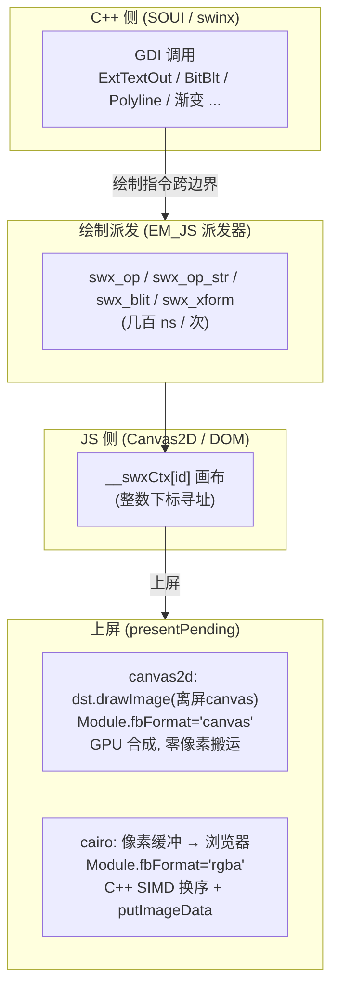

# SOUI wasm 渲染：两种 GDI 后端实现状态与 canvas2d 性能优化

> 适用版本：swinx wasm 渲染（route C = 基于浏览器 Canvas2D 重写 GDI 后端）。
> 配套文档：`swinx-wasm-design.md`（总体设计）、`swinx-wasm-canvas2d-残影修复说明.md`（clip 残影修复、GDI 语义对齐）。
> 实测口径：同机 headless Edge，wasm-demo 800×600；切页整窗重绘的
> **最重 rAF 帧墙钟（rafHeavy）= emscripten 主循环回调的同步执行时长（含 pump + paint）**，
> 这是后端无关的"画一帧到底要多久"指标。`present` 是单帧上屏（合成）耗时。

---

## 1. 概述

SOUI 是 C++ 写的 UI 框架，而浏览器里的实际像素是由 **JS 侧的 Canvas2D / DOM** 画出来的。
因此 wasm 渲染的第一性约束是——**每一笔 GDI 绘制调用都要跨过 wasm→JS 边界**。

wasm 提供**两套 GDI 后端实现**（由 `SWINX_WASM_GDI_BACKEND` 在配置期选定；该值记死在
CMakeCache 里，两套后端不能共用一个 build 目录）：

- **canvas2d（默认）**：用浏览器原生的 Canvas2D API 重写了整套 GDI 语义。
- **cairo**：在 wasm 里跑 cairo 软件光栅，把整帧画进一块 CPU 像素缓冲，再上传浏览器。

两条路径在"上屏"环节分叉，而性能的根本差异来自两点：**绘制交给谁做**（浏览器原生管线 vs
wasm 内软件光栅）以及 **跨边界成本怎么处理**。



---

## 2. 两种后端当前的实现状态

### 2.1 canvas2d 后端（默认）

- **渲染方式**：用浏览器原生 Canvas2D API 重写了整套 GDI 语义（`ExtTextOut` / `BitBlt` /
  `Polyline` / 渐变 / 裁剪 / 世界变换 …），绘制几何在 C++ 里算、在 JS 里画，光栅由浏览器
  原生管线（通常走 GPU）完成。
- **绘制派发**：高频、参数全为 int/double/指针、返回 void 的绘制调用走 **EM_JS 派发器**
  （`swx_op` / `swx_op_str` / `swx_blit` / `swx_xform`）；ctx 用**整数下标**
  `globalThis.__swxCtx[id]` 寻址（创建 canvas 时 `SwinxCtxRegister` 登记一次，之后只传
  `ctxId`）。字符串 / 对象类操作（渐变、图案、`measureText`）仍走 embind，属冷路径。
- **上屏**：`presentPending`（`gdi.cpp:1846`）把窗口脏矩形**直接 `drawImage` 合成到显示画布**
  （`SwxPresentSurface`，`js_glue.cpp:453`），并令 `Module.fbFormat='canvas'`
  （`SConnection.cpp:437`）让 JS 跳过 `HEAPU8` 像素搬运。窗口后备画布按 `getContext('2d',{alpha:false})`
  创建、全程只写不读。
- **字体**：走浏览器系统字体，无内置字体文件，`.data` 体积极小。
- **GDI 语义对齐细节**（文字度量基线、ETO_OPAQUE、位图源矩形换算、裁剪坐标、渐变端点等）
  见 `swinx-wasm-canvas2d-残影修复说明.md`。

### 2.2 cairo 后端

- **渲染方式**：在 wasm 里跑 cairo 软件光栅，把整帧画进一块 CPU 像素缓冲
  （`CAIRO_FORMAT_ARGB32`，小端内存布局为 **BGRA**），光栅在 CPU 上完成。
- **上屏**：`presentPending` 把 cairo 脏区**逐行拷进帧缓冲并就地 BGRA→RGBA 换序**
  （`SwinxBgraToRgba`，`SConnection.cpp:1756`），之后 `Module.fbFormat='rgba'`
  （`SConnection.cpp:445`）走 `soui-host.js` 的零拷贝快路径直接 `putImageData`。
- **换序实现**：`SwinxBgraToRgba` 移植自 `soui-android-lib/SouiSurfaceProxy.cpp` 的 SSSE3
  `_mm_shuffle_epi8`，在 `#if defined(__wasm_simd128__)` 下用 `wasm_v8x16_swizzle`（pshufb 等效）
  控制向量 `[2,1,0,3, …]` 完全一致；未开 `-msimd128` 时退回逐字节标量交换（逻辑一致，仅慢一点）。
  `wasm.cmake` 的 cairo 分支已 `add_compile_options(-msimd128)`（仅 cairo 构建带，canvas2d 不带）。
- **颜色**：正确。C++ 换序是 JS 兜底换序（`soui-host.js` 的 ARGB→RGBA）的严格逆运算，帧缓冲里
  就是浏览器需要的 RGBA，无红蓝对调。
- **字体**：内置 `msyh.ttc` 经 `--preload-file` 挂进 MEMFS（`.data` 因此 +20MB），fontconfig
  排版；代价是启动慢、fontconfig 告警。

### 2.3 实现状态对比

| 维度 | canvas2d（默认） | cairo |
|---|---|---|
| 光栅执行处 | 浏览器原生 Canvas2D（通常 GPU） | wasm 内 cairo 软件光栅（CPU） |
| 字体来源 | 浏览器系统字体 | 内置 msyh.ttc（.data +20MB） |
| 上屏机制 | `drawImage` 直合成（零像素搬运） | 像素缓冲 SIMD 换序 + `putImageData` |
| 颜色 | 原生正确 | C++ 换序后正确 |
| 窗口画布 | `alpha:false`、只写不读 | — |
| .data 体积 | ~0.8MB | ~20MB |
| 适用场景 | 通用默认 | 像素级一致 / 离线渲染 / 特定字体排版 |

---

## 3. canvas2d 当前采用的性能优化技巧

canvas2d 后端的绘制语义注定要调 JS 的 Canvas2D——优化**不是**"避免调 JS"（那不可能，也没必要，
浏览器原生绘制本身极快），而是把**跨边界成本逐项压到最低**。绝大多数技巧集中在
`swinx/src/gdi/canvas2d/{gdi.cpp,js_glue.cpp}`；其中 3.5 是落在 SOUI 核心层、与具体 GDI 后端无关的
共享优化（cairo 同样受益）。当前状态如下：

### 3.1 热路径禁用 embind → EM_JS 派发器 + 整数 ctxId
`val::call/val::set`（embind）每次要跨边界、把方法名当 `std::string` 转成 JS 串、把参数逐个装箱，
**单次 3~10µs**。改为 EM_JS 派发器（`swx_op / swx_op_str / swx_blit / swx_xform`）展开成普通
wasm `import`，V8 对整数/浮点直接调用只要**几百纳秒**。配套：`ctx` 用整数下标
`__swxCtx[id]`（`js_glue.cpp:312`），创建时登记一次；颜色串按 `COLORREF` 缓存
（`g.__swxColor`，`js_glue.cpp:286`）跨调用复用。C++ 侧经 `SwxOp/SwxOpStr/SwxBlit/SwxXform`
薄封装（`js_glue.cpp:424`），`gdi.cpp` 每个绘制点都是 `SwxOp(hdc->ctxId, op, ...)`（`gdi.cpp:81`）。

### 3.2 measureText 记忆化 + 字体未换不重设
整窗帧里 `measureText` 占 ~329 次，是全后端最热单项；每次跨边界 + 浏览器按 font 整形 + 返回打包成
`val` 的 `TextMetrics` 再查一次属性。当前用 `s_measureCache`（`gdi.cpp:486`）以
`cssFont + '\x01' + text` 为键记忆化（8192 上限粗粒度清空），几乎全命中。同时 `applyFont`
（`gdi.cpp:510`）做**字体对象未换不重设**（`fontTag` 判定），避免 `cssFont` 字符串每次经 embind
装箱——那是 `DrawText` 一帧几十上百次的热调用之一。

### 3.3 上屏 drawImage 直合成 + 去掉 willReadFrequently
旧上屏路径是 `getImageData → memcpy → putImageData`，一帧**两次全幅像素搬运**。当前改成窗口脏矩形
**直接 `drawImage` 合成**到显示画布（`SwxPresentSurface`，`js_glue.cpp:453`），`Module.fbFormat='canvas'`
让 JS 跳过 `HEAPU8` 搬运（`SConnection.cpp:437`）。窗口画布**不读回**，因此去掉了
`willReadFrequently`（`js_glue.cpp:46`）：钉在 CPU 软件光栅反而更慢（有头真 GPU 实测
spanMed 4.7→5.3ms）。

### 3.4 路径段全部并入 EM_JS 派发器
`beginPath / closePath / moveTo / lineTo / bezierCurveTo` 当前统一走 `Op(hdc, SWX_*)`，不再经 embind，
ops 不变、单次调用成本降。

### 3.5 SVG→位图 光栅化缓存（4 槽；对 canvas2d 尤为关键，cairo 同样受益）
把 SVG 绘制到内存位图（离屏 `IRenderTarget` 上的 `DrawSVG`）是一次**昂贵的光栅化**——最初正是
为了改善 canvas 把 SVG 画进内存位图性能偏低而引入。该缓存位于 **SOUI 核心层**
`SSkinImgList::GetSvgCacheBitmap`（`SOUI/src/core/SSkin.cpp:332`），与具体 GDI 后端无关：
它把整张 SVG 一次性光栅化成内存位图，按"尺寸"存进 4 个槽（`m_aSvgCache[4]` + 轮转
`m_nSvgCacheNext`，`SOUI/include/core/SSkin.h:227-235`），命中即复用、不再重光栅。HUD 图标、棋盘格、
列表行常同一张图按多种尺寸交替绘制，单槽会互相冲刷、导致每秒重建几十次。

**不同后端收益差异显著**：
- **canvas2d 对此最敏感**。canvas2d 把 SVG 光栅进内存位图走的是**软件光栅**，性能明显弱于 cairo；
  而这块内存位图随后还要**再搬一次**才能上屏——被 `drawImage`/`putImageData` 上传到 GPU 显示画布
  （内存 → GPU 的第二次搬运）。两道开销叠在一起，无缓存时每帧 SVG 都要付"弱软件光栅 + 内存上传"两次
  代价，所以这条缓存对 canvas2d **尤为重要**。
- **cairo 基本没有这个问题**。cairo 的帧缓冲本身就在 CPU 内存里，缓存位图与它同处一块地址空间，绘制时
  只是一次廉价的 CPU 内 blit，无需额外上传；且 cairo 自身的软件光栅强于 canvas2d 的软件路径。因此缓存
  对 cairo 收益有限——它只是顺带受益，而非关键优化。

### 3.6 日志按需取时间
`swinx/src/log.cpp` 的 `GetLocalTime` 改到**真正要输出时**才调（wasm 上落 `__localtime_js`：建 JS
`Date` + 分配 `struct tm`），被级别过滤掉的日志不再付费。

### 3.7 状态缓存随 save/restore 入栈出栈
浏览器 `ctx` 状态无脏检查，缓存有效；但 `ctx.save/restore` 整体回滚状态，所以
`SaveState: st.c2d = c2d` / `RestoreState: c2d = st.c2d`（清空整栈分支保留最后一档），保证缓存与
`ctx` 真实状态一致。

### 优化技巧汇总

| # | 技巧 | 落地点 | 压低的跨边界开销 |
|---|---|---|---|
| 3.1 | EM_JS 派发器 + 整数 ctxId | `js_glue.cpp` `swx_op*`；`gdi.cpp:81` | embind 每次 3~10µs 的装箱 |
| 3.2 | measureText 记忆化 + 字体未换不重设 | `gdi.cpp:475-529` | 重复文本整形 + 字体串装箱 |
| 3.3 | 上屏 drawImage 直合成 + 去 willReadFrequently | `js_glue.cpp:38-59,453`；`SConnection.cpp:437` | 每帧两次全幅像素搬运 |
| 3.4 | 路径段并入 EM_JS 派发器 | `gdi.cpp` `Op(hdc, SWX_*)` | 路径基元 embind 成本 |
| 3.5 | SVG→位图 光栅化缓存（4 槽；canvas2d 尤关键，cairo 也受益） | `SOUI/src/core/SSkin.cpp:332` `GetSvgCacheBitmap`；`SSkin.h:227-235` | 同 SVG 多尺寸反复重光栅；canvas2d 软件光栅弱 + 内存→GPU 二次搬运 |
| 3.6 | 日志按需取时间 | `swinx/src/log.cpp` | 被过滤日志仍付 `__localtime_js` |
| 3.7 | 状态缓存随 save/restore | `SaveState/RestoreState` | ctx 状态回滚后缓存漂移 |

---

## 4. 两种后端性能对比（当前实测）

| 后端 | 整窗重绘中位 (rafHeavy) | P90 | 上屏 present (均) | 上屏机制 |
|---|---|---|---|---|
| **cairo** | **11.4 ms** | 20.6 ms | **0.37 ms** | 像素缓冲 `putImageData`（C++ SIMD 换序） |
| **canvas2d** | **5.4 ms** | 15.4 ms | **0.26 ms** | `drawImage` 直合成 |

**结论**：canvas2d 把绘制交给浏览器原生图形管线，只在必要处做轻量跨边界；cairo 每帧仍要"在 wasm
内做软件光栅 + 上传像素缓冲"，即便做到零拷贝 + SIMD 换序也追不上——**瓶颈不在"传像素"，而在
"谁来做光栅"**：浏览器原生 Canvas2D 比 wasm 内的 cairo 软件光栅快一个数量级。

---

## 5. 结论与适用场景

1. **默认后端用 `canvas2d`**：它是把跨边界成本压到最低的路径（5.4ms/帧），且颜色、字体走浏览器原生。
2. **cairo 现已正确且尽可快**：C++ SIMD 换序 + 零拷贝让上屏降到 ~0.5ms、颜色正确；但整窗重绘仍
   ~2.1× 慢于 canvas2d，根因是软件光栅。
3. **cairo 适用场景**：需要"像素级一致 / 离线渲染 / 特定字体排版（内嵌 msyh.ttc）"时才有意义；
   代价是 ~20MB `.data`、fontconfig 告警、启动慢。
4. **框架级提醒**：`-msimd128` 加在 `swinx/wasm.cmake` 的 cairo 分支，**所有 wasm 工程的 cairo
   构建都会带上**。现代浏览器（Chrome/Edge/Firefox/Safari，2021 起）已基线支持，属良性改动；若某天
   要支持极老的 wasm 运行时，去掉这条即可（SIMD 分支自动退回标量，逻辑不变、仅慢一点）。

---

## 6. 复现与验收

- 构建两个后端（**不能共用一个 build 目录**，CMakeCache 记死 `SWINX_WASM_GDI_BACKEND`）：
  ```bat
  build.bat build-cairo --gdi=cairo
  build.bat build-c2d   --gdi=canvas2d
  ```
- 产物入口：`out-cairo/soui-wasm-demo.html`、`out-c2d/soui-wasm-demo.html`（pump 版，
  普通 `python -m http.server` 即可起，无需 COOP/COEP）。
- 上屏成本核对：页面加 `?perf=1`，`soui-host.js` 会打印 present 日志；
  cairo 见 `fbFormat=... rgba`、canvas2d 见 `fbFormat=... canvas`。
- 颜色 sanity：显示画布像素 diff（cairo vs canvas2d），`fracStrong` 应在个位数百分比
  （文本字形差异），而非接近全部彩像素（那意味着红蓝对调）。
