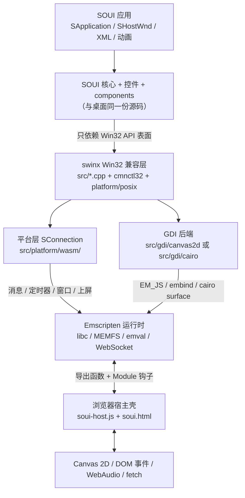
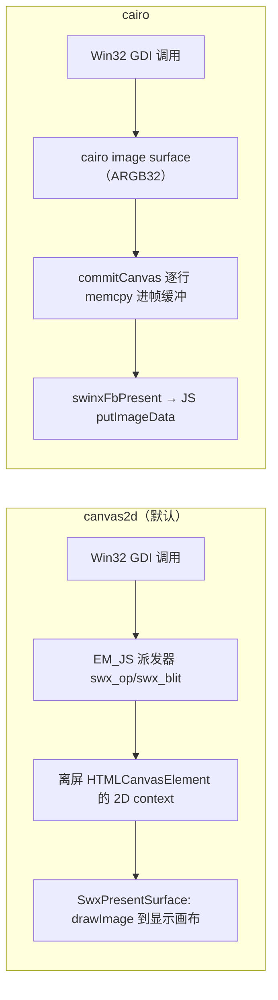
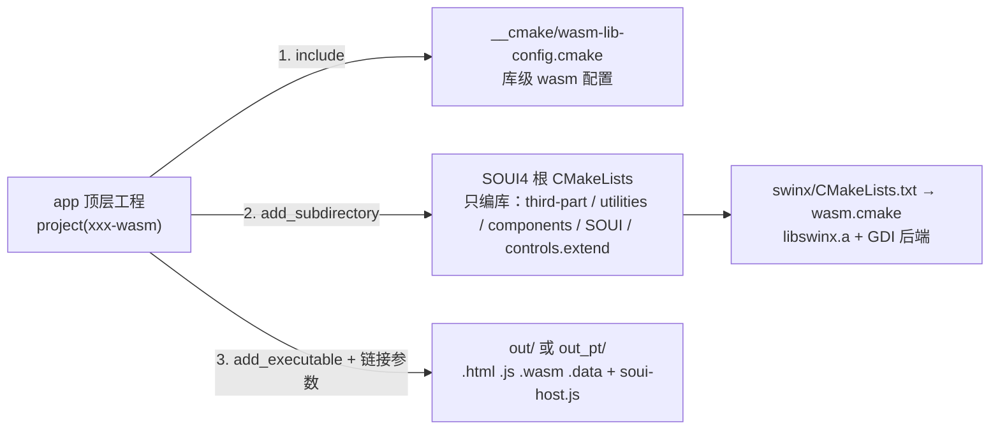
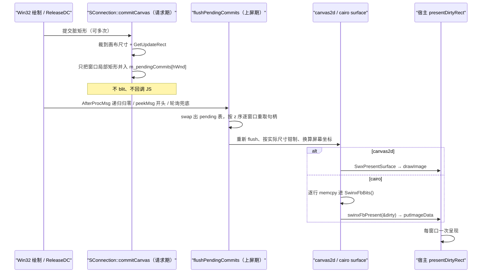

# swinx WebAssembly 设计与实现

> **本文是 swinx WebAssembly 端口的权威设计与实现说明**，面向维护/扩展该端口，或为 SOUI 应用新增一个 wasm 版本的开发者。
>
> 原立项调研 / 阶段实施日志（历史 plan）已从仓库移除，不再引用；工程入口、开关名、后端形态一律以本文与当前源码为准。
>
> 适用范围：`D:/work/soui4`（SOUI4/对外 SOUI5）主仓库与 `swinx` 子模块，对应 2026-11「四个 app 各自为独立顶层 CMake 工程」的重构后状态。路径均相对主仓库根，`swinx/...` 表示子模块内。文中行号基于当前工作区，随提交可能微调；涉及结论处同时给出文件与符号名，便于重新定位。

---

## 0. 一页速览

| 维度 | 结论 |
|---|---|
| 移植落点 | SOUI 核心、控件、布局、XML 资源、动画**零改动**；新增 `swinx` 的 wasm 平台后端、GDI 后端与浏览器宿主壳 |
| 兼容面 | swinx 提供的 Win32 API 表面（`HWND/HDC/MSG/WNDPROC/GDI/IMM/OLE`），非 Windows 端一律由它承接 |
| GDI 后端 | `canvas2d`（默认）：绘制与字体交给浏览器 Canvas 2D；`cairo`：wasm 内软件光栅化 + FreeType/fontconfig |
| 链接形态 | 全静态。浏览器无 `dlopen`，组件必须编进同一个 wasm 模块（`SOUI_ENABLE_CORE_LIB/COM_LIB=ON`） |
| 主循环 | 浏览器主线程**不可阻塞**。`emscripten_set_main_loop(..., 0, 1)` 跟随 rAF，单次泵有帧预算；消息型/回调型定时器由端口层投递 |
| 构建 | 根 `CMakeLists.txt` 不感知 wasm；每个 app 自己是顶层工程，`include(__cmake/wasm-lib-config.cmake)` 后 `add_subdirectory(<soui4>)` **仅编库** |
| 现有四条腿 | `demos/wasm-demo`（演示）、`games/cnchess/client/wasm`（联网对战）、`demos/fundholdings/wasm`（桌面版 UI + HTTP）、`demos/fun_test/wasm`（GDI 单测 A/B） |
| 线程 | 默认单线程（泵后端）；`SOUI_WASM_PTHREADS=ON` 切真 worker，代价是站点必须 `crossOriginIsolated` |
| 资源 | `--preload-file` 打进 `.data`（MEMFS/WASMFS）；canvas2d 后端**不预载字体**，cairo 后端必须预载 |

一句话：**wasm 端口 = 一套新的 `SConnection` + 一套 GDI 后端 + 一份 JS 宿主契约**，其余都是 SOUI 既有代码的复用。

---

## 1. 设计目标与平台边界

### 1.1 目标

1. 让 SOUI 应用在浏览器里以**原有 C++ 源码**运行，不维护一套 Web 专用 UI 层。
2. 把平台差异继续收敛在 `swinx` 的两处集中点：平台层 `SConnection` 与绘制后端 `src/gdi/<backend>/`，与 Linux / macOS / iOS / Android / OHOS / FreeRTOS 的移植边界一致。
3. 让「编哪个 app、开哪些组件、用什么后端」由 **app 自己的 CMake 工程**决定，库侧只提供能力，不预设组合。
4. 能力缺失必须**显式失败**，不得伪造（返回 `S_OK` 的假 OLE、假 `HIMC`、把「不支持」伪装成「用户取消」都会把问题推迟到运行期）。

### 1.2 浏览器给的硬约束

| 约束 | 后果 | 端口里的应对 |
|---|---|---|
| 没有窗口服务器、没有原生 HWND | 不能复用 X11/Cocoa/Android 的宿主窗口 | `SConnection` 从 `src/platform/freertos/` 分叉，所有窗口都是 swinx 内部的虚拟 `_Window`；`wasm.cmake:49-54` 明确**不定义** `ENABLE_VIRTUAL_HWND` |
| 没有 `dlopen` | 组件无法运行时加载 | 全静态：`SOUI_ENABLE_CORE_LIB/COM_LIB=ON`，`__cmake/wasm-lib-config.cmake:23-24`；`SRichEdit` 走 `INIT_RICHEDIT` 静态 msftedit（同文件 `:34-37`） |
| 主线程阻塞 = 标签页冻死 | 不能 `GetMessage` 阻塞、不能 `Atomics.wait`、不能在 wasm 里等 DOM 事件 | `getMsg()` 队列空直接返回 FALSE（`SConnection.cpp:906-913`）；泵有帧预算；文件选择改成异步契约（§8.4） |
| 同步对话框不存在 | `GetOpenFileNameA` 无法本次调用内返回 | 保留同步版显式拒绝，新增 `SwinxPickFileAsyncA`（`swinx/include/commdlg.h:253-284`） |
| 无本地 IME / 音频设备 / 系统剪贴板 | `Imm*` 全部无源、`PlaySound` 无声 | IME 桩显式失败，组合输入由 DOM 事件注入；音频走宿主 WebAudio 钩子；剪贴板走 `clipboardData` / `navigator.clipboard`（§7.4） |
| wasm32 线性内存从 0 开始 | `IS_INTRESOURCE` 判据 `(ptr>>16)==0` 会把低 64 KB 的字符串字面量当成整数原子号 | 链接钉 `-Wl,--stack-first`，并加启动自检 `lowmem.cpp`（§9） |
| 跨源与线程隔离 | `-pthread` 产物含 `SharedArrayBuffer` | 只有 worker 腿需要 COOP/COEP 响应头，由 `tools/wasm/serve-isolated.py` 提供；默认泵腿任意静态服务即可 |
| 没有可重入的嵌套消息循环 | iOS 那种 `dispatch_semaphore` + 嵌套 runloop 的「异步包同步」不可用 | 结论：只做真异步 API，不用 `-sASYNCIFY` 把代价摊给整个模块 |

---

## 2. 总体架构



| 层 | 主要位置 | 职责 |
|---|---|---|
| 应用 | `demos/wasm-demo/soui_main.cpp`、`games/cnchess/client/wasm/cnchess_main.cpp`、`demos/fundholdings/wasm/` | `SApplication` + `SHostWnd`、导出 C API、加载资源、启动主循环 |
| SOUI 核心/组件 | `SOUI/`、`controls.extend/`、`components/` | 控件、布局、皮肤、动画、XML 解析；wasm 下静态链入同一模块 |
| swinx 兼容面 | `swinx/src/*.cpp`、`swinx/src/cmnctl32/`、`swinx/src/platform/posix/` | Win32 窗口/GDI/内核对象语义；posix 层与 Linux/macOS/iOS/移动端共用 |
| wasm 平台层 | `swinx/src/platform/wasm/` | 消息队列、定时器、窗口 z 序、帧缓冲、输入注入、剪贴板、文件选择、音频 |
| GDI 后端 | `swinx/src/gdi/canvas2d/` 或 `swinx/src/gdi/cairo/` | DC/位图/文本/路径绘制与上屏 |
| 宿主壳 | `demos/wasm-demo/soui-host.js`、`soui.html`、`tools/wasm/serve-isolated.py` | canvas、事件注入、IME 代理、WebAudio、加载进度、隔离响应头与 WS 隧道；需要同源 HTTP 转发的 app 另有自己的服务入口（如 `demos/fundholdings/wasm/serve-fundholdings.py`） |

两条绘制路径的差别集中在「谁光栅化」：



---

## 3. 构建体系

### 3.1 三层结构



重构后的关键约定：

- 根 `CMakeLists.txt:234-239` 有保护：`if(EMSCRIPTEN AND NOT SOUI_WASM_MINIMAL) FATAL_ERROR`，禁止在 Emscripten 下直接 `cmake -S .` 编出「桌面库塞进 wasm」的坏构建。
- 顶层工程里 `CMAKE_SOURCE_DIR` / `PROJECT_SOURCE_DIR` 指向 **app 目录**；所有指向仓库根的路径必须用 `SOUI4_DIR`，配置产物目录用 `SOUI4_BUILD/config`。这是把 app 提成顶层工程后最容易踩的坑。
- 组件白名单不写在库配置里，由 `third-part/CMakeLists.txt:1-37` 与 `components/CMakeLists.txt:34-70` 各自的 `SOUI_WASM_MINIMAL` 分支自己决定（`__cmake/wasm-lib-config.cmake:12-14`）。

### 3.2 库级配置 `__cmake/wasm-lib-config.cmake`

| 变量 / option | 默认 | 作用 |
|---|---|---|
| `SOUI_WASM_MINIMAL`（`:19`） | `ON` | 最小库总开关，被 third-part / components / 根 CMakeLists 消费 |
| `SOUI_ENABLE_CORE_LIB`、`SOUI_ENABLE_COM_LIB`（`:23-24`） | `ON` | 静态形态，wasm 无 dlopen 的前提 |
| `SOUI_BUILD_DEMOS/GAMES/TOOLS`（`:28-30`） | `OFF` | app 由顶层工程自己编，库不编 demo |
| `SOUI_BUILD_HTTPCLIENT`、`SOUI_BUILD_WS`（`:31-32`） | `OFF` | 覆盖桌面默认 ON；需要者由自己的脚本 `-D...=ON` |
| `SOUI_BUILD_RICHEDIT`（`:37`） | `ON` | `<edit>` 需要静态 msftedit |
| `SOUI_ENABLE_SVG`（`:43`） | `ON` | Lua 游戏页的 `svg:` 皮肤 |
| `SOUI_ENABLE_SPY`、`SOUI_ENABLE_ACC`（`:45-46`） | `OFF` | 浏览器侧无对应能力 |
| `SOUI_BUILD_WASM_SCINTILLA`（`:52-53`） | `ON` | Scintilla + `<scintilla>` 控件，关掉省体积 |
| `SOUI_WASM_PTHREADS`（`:62-63`） | `OFF` | worker 线程总开关（§3.7） |
| `-Wno-inconsistent-missing-override`（`:87`） | — | Emscripten 用 clang，根工程按目标平台判断的告警抑制在交叉编译时不生效 |

### 3.3 组件与第三方白名单

`components/CMakeLists.txt:24-32` 用 `_soui_components` 列表统一生成 `SOUI_BUILD_<NAME>` 开关，**默认全 ON**；桌面、移动端、wasm 共用同一套开关名：

| 组 | wasm 最小分支（`components/CMakeLists.txt:34-70`） | 依赖/备注 |
|---|---|---|
| 图像与渲染 | `IMGDECODER_STB`、`RENDER_GDI` | stb 是 header-only；renderer 走 GDI 兼容面 |
| 任务循环 | `TASKLOOP` | wasm 下双后端，见 §8.1 |
| 可选网络 | `HTTPCLIENT`（默认 OFF）、`WS`（默认 OFF） | 打开后分别走同步 XHR 后端与浏览器原生 WebSocket，不碰 curl/openssl/libwebsockets |
| 脚本 | `SCRIPT_LUA`、`TRANSLATOR` | 二者已解耦：`ScriptModule-LUA/CMakeLists.txt:79-85` 仅在编译 translator 时定义 `SOUI_BUILD_TRANSLATOR`，`exp_global.h:190-203` 用它包住 `CreateTranslatorMgr` |
| 资源 | `RES_ZIP` | wasm 走 swinx 的 `zlib_static`，不引 `third-part/zlib`（重复符号） |

`third-part/CMakeLists.txt:1-37` 只拉起 `pbl_aupng`、`richedit41`，并按开关加入 `Scintilla`、`lua-54`、`gtest`（`SOUI_BUILD_WASM_FUN_TEST`，仅 fun_test 腿设置），然后 `return()`。**刻意不加 zlib**：主仓库与 swinx 各有一份 inflate/deflate 符号，wasm 全静态链接会直接 duplicate symbol。

> 依赖第三方库的组件靠 `TARGET` 自然门控（如 `TARGET websockets`、`TARGET 7z`），库侧不为任何特定 app 预设组合。

### 3.4 四个 app 顶层工程

| 工程 | `project()` | `SOUI4_DIR` 深度 | 可执行目标 | 产物目录 | 特点 |
|---|---|---|---|---|---|
| `demos/wasm-demo` | `wasm-demo`（`CMakeLists.txt:29`） | `../..` | `soui-wasm-demo`（`:188`） | `out/`（`:38-39`） | 全功能演示；11 页控件、Lua 游戏、SVG 皮肤 |
| `games/cnchess/client/wasm` | `cnchess-wasm`（`:2`） | `../../../../` | `cnchess-wasm`（`:123`） | `out_pt/`（`-pthread`）/ `out/`（`:42-48`） | 浏览器原生 WebSocket；另加 `games/cnchess/algorithm` |
| `demos/fundholdings/wasm` | `fundholdings-wasm`（`:2`） | `../../..` | `fundholdings-wasm`（`:81`） | `out_pt/` / `out/`（`:28-34`） | 1440×860 桌面版资源、`-DSOUI_BUILD_HTTPCLIENT=ON` |
| `demos/fun_test/wasm` | `fun_test-wasm`（`:16`） | `../../..` | `fun_test`（`:62`） | `../out.<backend>/`（`:41`） | 只编 4 个纯 GDI 用例；`SOUI_BUILD_WASM_FUN_TEST ON CACHE INTERNAL`（`:25-26`）把 gtest 拉进最小图 |

`out/` 与 `out_pt/` 必须分开：`.js/.wasm/.data` 三件套混放会出现「新 wasm 配旧胶水」的 `LinkError`（`games/cnchess/client/wasm/CMakeLists.txt:30-36`）。`wasm-demo` 自身不按后端分目录，CI 因此让两条腿各占一台 runner。

### 3.5 构建命令

各工程都是 `emcmake cmake -S <app 目录>`，**不要**再传 `SOUI_BUILD_WASM_DEMO/CNCHESS/FUNDHOLDINGS`（这些 app 选择开关已随重构删除）：

```bash
# 演示（Ninja 是 Windows 主机唯一可用的生成器）
emcmake cmake -S demos/wasm-demo -B build-wasm -G Ninja \
  -DCMAKE_BUILD_TYPE=RelWithDebInfo
cmake --build build-wasm --target soui-wasm-demo

# 中国象棋（worker 腿）
emcmake cmake -S games/cnchess/client/wasm -B build-cnchess -G Ninja \
  -DCMAKE_BUILD_TYPE=Release -DSOUI_WASM_PTHREADS=ON
cmake --build build-cnchess --target cnchess-wasm

# 基金持仓（需要 HTTP 能力）
emcmake cmake -S demos/fundholdings/wasm -B build-fund -G Ninja \
  -DCMAKE_BUILD_TYPE=RelWithDebInfo -DSOUI_WASM_PTHREADS=ON \
  -DSOUI_BUILD_HTTPCLIENT=ON -DSWINX_FB_WIDTH=390 -DSWINX_FB_HEIGHT=844
cmake --build build-fund --target fundholdings-wasm

# GDI 单测（两个后端各编一次做 A/B）
emcmake cmake -S demos/fun_test/wasm -B build-ft-c2d -G Ninja \
  -DCMAKE_BUILD_TYPE=Debug -DSWINX_WASM_GDI_BACKEND=canvas2d
cmake --build build-ft-c2d --target fun_test
node demos/fun_test/wasm/run-node.js
```

包装脚本：`demos/wasm-demo/build-soui.sh|build.bat`、`games/cnchess/client/wasm/build-cnchess.sh|build.bat`、`demos/fundholdings/wasm/build-fundholdings.sh|build.bat`。它们的 `cmake -S` 都指向脚本所在目录（`$HERE` / `%HERE%`），重配探针用 `CMAKE_PROJECT_NAME:STRING=<app>` 判断构建目录是否属于本工程。`demos/fun_test/wasm` 没有包装脚本，按上面的命令直接用。

> `demos/wasm-demo/build.sh` 是阶段 0 手写 `em++` 的遗留脚本（导出表还是旧的 `_SwinxDemoStat/_SwinxDemoRepaint`），**已弃用，不要复用**。

### 3.6 链接参数与产物

`SUFFIX ".html"` 让 emcc 产出 `.html / .js / .wasm / .data` 四件，`soui-host.js` 由 POST_BUILD 拷入成为第五个文件（`demos/wasm-demo/CMakeLists.txt:190-196`、`:346-354`）。

| 参数 | 作用 |
|---|---|
| `-lembind` | canvas2d 用 `emscripten::val` 持有 canvas/context，`_emval_*` 运行时由 embind 提供（`wasm-demo/CMakeLists.txt:302-305`） |
| `-sMODULARIZE=1 -sEXPORT_NAME=...` | 工厂函数（`createSouiDemo` / `createCnchess` / `createFundHoldings`），宿主自行控制实例化；fun_test 不用 |
| `-sEXPORTED_FUNCTIONS=...` | JS→wasm 的导出表，唯一真相在各 app 的 CMakeLists（`wasm-demo:185-186`） |
| `-sEXPORTED_RUNTIME_METHODS=HEAPU32,HEAP32,HEAPU8` | 宿主读写线性内存；fun_test 不需要 |
| `-sALLOW_MEMORY_GROWTH=1`、`-sSTACK_SIZE=32MB` | 内存与主线程栈 |
| `-Wl,--stack-first` | 把数据段推到 64 KB 以上，见 §9；ASAN 构建省略（`-O0` 默认已是 stack-first） |
| `--preload-file` | `uires`、系统资源、`snd`（仅 LUA）、字体（仅 cairo）；fun_test 明确不预载 |
| `-sEXIT_RUNTIME=1` | **仅 fun_test**（`:103`），gtest 跑完要拿退出码 |
| `-sASSERTIONS=2` | 默认只在 fun_test 打开，定位缺陷用 |

### 3.7 pthreads 与隔离头

`SOUI_WASM_PTHREADS=ON` 时库配置统一加 `-pthread`、`SOUI_WASM_PTHREADS=1` 宏，以及 `-sWASMFS=1 -sINITIAL_MEMORY=64MB -sGROWABLE_ARRAYBUFFERS=1`（`__cmake/wasm-lib-config.cmake:64-82`）：

- **WASMFS**：默认 JS 文件系统下 worker 的每次 stdio 都要主线程在 futex 忙等里代跑，而本端口主线程从不阻塞，实测 worker 的 `fopen` 永不返回。
- **INITIAL_MEMORY > STACK_SIZE**：硬性要求（32 MB 栈 → 64 MB 初始内存）；worker 自己的栈另按 4 MB 从堆里分配。
- **代价**：产物含 `SharedArrayBuffer`，页面必须 `crossOriginIsolated`。`tools/wasm/serve-isolated.py` 的 `end_headers()` 发 `Cross-Origin-Opener-Policy: same-origin` 与 `Cross-Origin-Embedder-Policy: require-corp`；普通 `python3 -m http.server` 跑不了 worker 腿。

因此该开关**默认 OFF**，默认产物、壳页与门禁都不变。

### 3.8 CI

`.github/workflows/soui-wasm-gate.yml` 的 matrix 两条腿：`backend: pump / pthreads OFF` 与 `backend: pthreads / pthreads ON`（`:61-70`）。配置走 `-S demos/wasm-demo`（`:114-118`），构建 `soui-wasm-demo`（`:122-126`），再用 `node demos/wasm-demo/smoke.js` 断言并校验 `[taskloop] pt=<0|1>`（`:128-138`）。`paths:` 已包含 `__cmake/**`，库配置改动会触发门禁。

---

## 4. swinx 平台层

### 4.1 平台分派与源集

`swinx/CMakeLists.txt:46-61`：`SOUI_PLATFORM=wasm` 或 `elseif(EMSCRIPTEN)` 都进 `wasm.cmake`；Emscripten 绝不能落到 `linux.cmake`（那会 glob X11/DBus/xkbcommon/ALSA）。同文件 `:29-31` 固化 cairo 交叉编译的 `SIZEOF_UINT64_T=8`，`:13-18` 固化 `try_run` 的构造/析构属性探测结果。

`swinx/wasm.cmake` 的形态**仿 `mobile.cmake` 而非 `freeRTOS.cmake`**（`:4-27`）：Emscripten 有 musl libc、pthreads、真实 `<mutex>/<thread>/<chrono>`、`dirent`、`dlfcn`，不需要 freertos 那套裸机 STL 垫片，编进来反而和 posix 实现冲突。

| 项 | 内容 |
|---|---|
| 源文件 | `src/*.cpp`、`src/cmnctl32/*`、`src/platform/posix/*.cpp`、`src/platform/wasm/*.cpp`、`src/gdi/<backend>/*.cpp`（`:119-136`） |
| 排除 | canvas2d 分支用 `list(FILTER SRCS EXCLUDE REGEX "/src/sdc\\.cpp$")`：`src/sdc.cpp` 只含 cairo/apple 的 `HDC__` 生命周期（`:127-132`） |
| 宏 | `SOUI_PLATFORM_WASM`（`:47`）、`SWINX_WASM_CANVAS2D` + `SWINX_NO_LIBPNG/SWINX_NO_FONTCONFIG`（`:74-79`）、`WCHAR_SIZE=__SIZEOF_WCHAR_T__`（Emscripten 下为 4，`:97`）、`SWINX_FB_WIDTH/HEIGHT`（`:111`） |
| 后端变量 | `SWINX_WASM_GDI_BACKEND` 默认 `canvas2d`，取值 `canvas2d`/`cairo`（`:66-72`）。必须是 `set(... CACHE STRING)`：用 `option()` 会把字符串归一成 `OFF` |
| 帧缓冲尺寸 | `SWINX_FB_WIDTH/HEIGHT` 默认 800×600（`:106-107`），由 app 用 `-D` 改（fundholdings 用 390×844） |
| 链接 | cairo：`cairo fontconfig freetype pixman-1 ${CMAKE_DL_LIBS} m`（`:167-170`）；canvas2d：仅 `${CMAKE_DL_LIBS} m`（`:175`） |
| 目标 | `add_library(swinx STATIC ...)`（`:144`） |

### 4.2 窗口与消息队列

`SConnection.h/.cpp` 从 `freertos` 分叉，是整条端口的中枢：

- 窗口全是 swinx 内部的虚拟 `_Window`；`OnWindowCreate` 把顶层窗口压进 `m_zTop`（`SConnection.cpp:2131-2191`），销毁/移动/显隐时置 `m_bScreenDirty`，上屏阶段按 z 序重组。
- `postMsg` 合并 `WM_PAINT`、合并 `WM_MOUSEMOVE`、对 `WM_TIMER` 去重（`:915-959`）——浏览器一帧很贵，重复消息直接放大成本。
- `getMsg()` 队列为空**直接返回 FALSE**，不进 `waitMsg`（`:906-913`）；`peekMsg()` 开头先 `flushPendingCommits()` 再 `updateMsgQueue(0)`（`:848-904`）。
- `SClipboard` 的实现也在这个 TU 里（`:54-392`），wasm 目录没有独立 `SClipboard.cpp`。

### 4.3 定时器

`TimerInfo`（`SConnection.h:47-54`）由连接内维护，`updateMsgQueue()` 每次泵开头按 `GetTickCount()` 把到期定时器投一条 `WM_TIMER`（`SConnection.cpp:593-619`）。

**两条语义必须分清**（这是历史上真实踩过的坑）：

| 类型 | Win32 语义 | wasm 实现 |
|---|---|---|
| 消息型（`hWnd != NULL`, `proc == NULL`） | 进消息队列，由 `DispatchMessage` 派发 | 正常投递；SOUI 的动画脉冲 `kPulseTimer` 属此类 |
| 回调型（`hWnd == NULL`, `TIMERPROC != NULL`） | **由 `PeekMessage`/`GetMessage` 内部调用 proc，不产生可派发消息** | `peekMsg` 里 `lParam` 取出 proc 直接回调（`:874-893`）；`getMsg` 复用同一路径 |

脚本层 `ITimer` / `STimerGenerator` 用的是回调型（`::SetTimer(NULL, 0, nElapse, _TimerProc)`）。若把 proc 塞进 `lParam` 却没人读，`DispatchMessage` 会因 `!pMsg->hwnd` 把消息丢掉，表现为「动画活着、脚本计时器全静默」。

### 4.4 帧缓冲、DPI 与缩放

`framebuffer.h/.cpp` 提供 `SwinxFbBits / Width / Height / Stride / LogicalWidth / LogicalHeight / Requests / Presents` 与呈现回调 `SwinxSetFbPresentCb`（`framebuffer.h:26-73`）。

- **实现是堆分配**：`SwinxSetCanvasScale()` 按缩放重建缓冲并清成不透明黑（`framebuffer.cpp:27-39`），钳制 `0.5 < scale <= 3.0`；JS 每次 present 重新读 `Module._SwinxFbBits()`，因为内存增长可能搬动堆。
- **只设一次**：`main()` 最开始调一次，浏览器拖到另一台显示器导致的 dpr 变化要刷新页面才生效（`framebuffer.h:36-39`）。
- **档位由 C++ 侧决定**：`demos/wasm-demo/soui_main.cpp:1695-1731` 读 `emscripten_get_device_pixel_ratio()`（可用 `?dpr=` 覆盖），**向上贴** `SDpiScale` 内置档位，超采样上限 1.15 倍，然后 `SwinxSetCanvasScale(nScale/100)`。`SConnection::GetDpi()` 按 `96 * scale` 回报（`:1148-1154`）。`soui-host.js` 不读 dpr，只按 `_SwinxFbWidth/Height/Stride` 设 canvas 物理尺寸、按 Logical 尺寸设 CSS。
- canvas 的显示宽必须等于逻辑宽，别给页面写死 CSS 宽去拉伸，否则多一层插值，档位抬到多少都发虚。

### 4.5 输入注入

`swinx/src/platform/wasm/input.h/.cpp` 提供三个 C++ 入口（注意：它们是 swinx 内部函数，**不在 wasm 导出表**，由 app 的 `SwinxDemo*` 包一层）：

| 入口 | 语义 |
|---|---|
| `SwinxInjectMouse(hWnd, msg, x, y, fwKeys)` | 屏幕坐标 → 客户区；capture / `WindowFromPoint` 路由；`fwKeys` 对账按键状态（`input.cpp:35-82`） |
| `SwinxInjectKey(hWnd, msg, vk, scanCode)` | 合成 `WM_KEYDOWN/UP` 等，Lock 键切换（`:84-108`） |
| `SwinxInjectText(hWnd, utf8)` | UTF-8 逐码点 `postMsg(WM_IME_CHAR, cp, 0)`；**不发** `WM_KEYDOWN/WM_CHAR`（`:162-191`） |

`WM_IME_CHAR` 这条路径很重要：一次组合输入不是一次物理按键，伪造键位会让 `GetKeyState` 与 Ctrl 组合判断跟着错；而非 Unicode 构建下 `SRichEdit::OnChar` 的 DBCS 累加器会把 `输/人` 这类低字节落在 GBK 前导区的汉字拼成乱码。wasm 的 `WCHAR_SIZE=4`，一条消息一个码点直接进 richedit41 即可。

### 4.6 能力的显式缺席

| 文件 | 形态 |
|---|---|
| `imm.cpp` | 20+ 个 `Imm*` 桩，一律 `NULL/FALSE`；组合输入由 DOM 的 `composition*` 事件在宿主层接管（`:1-23`） |
| `ole2.cpp` | `RegisterDragDrop/RevokeDragDrop/DoDragDrop` 返回 `E_FAIL/E_NOTIMPL`（`:20-47`）；返回 `S_OK` 会让 `IDropTarget` 永远收不到 `DragEnter` |
| `SClipboard.h` + `SConnection.cpp:266` | 进程内剪贴板 + `SwinxClipboardSetBrowserText` 接收宿主 paste |
| `audio.cpp` | `PlaySound` 只支持 `SND_FILENAME`，读 MEMFS 后经 `EM_ASM` 调 `Module.swinxAudioPlay`（`:65-99`）；宿主没装钩子时返回 FALSE，不假装入队 |
| `dlghelper.cpp` | 同步对话框一律 `ERROR_CALL_NOT_IMPLEMENTED`；异步文件选择见 §8.4 |
| `lowmem.cpp` | 启动自检，见 §9 |
| `utils.cpp` | `swinx_messageBeep` 显式返回 FALSE |

原则是「能力不存在」与「能力存在但坏了」要能区分。

### 4.7 启动自检：数据段下界

`IS_INTRESOURCE(p) == (((ULONG_PTR)p >> 16) == 0)` 在桌面天然成立；wasm-ld 在 `-O1` 以上默认 `--no-stack-first --global-base=1024` 时，静态数据段落在低 64 KB，字符串字面量 `"HOSTWND"` 会被当成原子号，`CreateWindowExA` 直接返回 0、`SHostWnd::Create()` 失败且 `GetLastError()=0`——症状看起来像 XML 配置错。

- 修法：链接钉 `-Wl,--stack-first`（或 `-Wl,--no-stack-first -Wl,--global-base=65536`，`--global-base` 必须带 `-Wl,` 前缀）。
- 自检：`lowmem.cpp:15` 的 `SWINX_WASM_PTR_FLOOR 0x10000u`，读 wasm-ld 的 `__global_base`（静态数据段下界，而非取某个字面量地址——后者会单点误判），不满足就打印修法并 `abort()`。调用点在 `atoms.cpp:23` 与 `SConnection.cpp:424`。

---

## 5. GDI 后端

### 5.1 两个后端对比

| 维度 | `canvas2d`（默认） | `cairo` |
|---|---|---|
| 光栅化 | 浏览器 Canvas 2D | wasm 内 cairo image surface（ARGB32） |
| 字体 | 浏览器系统字体（CSS font family），`measureText` + `fillText` | fontconfig + FreeType，字体文件必须 `--preload-file` |
| 依赖 | 不链 cairo/pixman/freetype/fontconfig/brotli、不链 libpng | `cairo fontconfig freetype pixman-1`（`wasm.cmake:167-170`） |
| 内置 PNG | 自带精简解码器（inflate + unfilter，`builtin_image.cpp:7-15`） | 借 cairo/libpng 的 `cairo_image_surface_create_from_png_stream` |
| 上屏 | `SwxPresentSurface` → `drawImage(src.canvas, ...)`（`js_glue.cpp:445-468`） | `commitCanvas` 逐行 `memcpy` 进 `SwinxFbBits()` → `swinxFbPresent` → JS `putImageData` |
| 标准 | C++17（结构化绑定、`emscripten::val`），需 `-lembind` | C++11，纯 C/C++，不碰 JS |
| 适用 | 现在的主力后端；A/B 与精度对照用 cairo | 后端差分、无浏览器字体依赖的对照基线 |

后端由 `SWINX_WASM_GDI_BACKEND` 在**配置期**选择，不是运行期切换；两套产物分别落在 `out.canvas2d/` 与 `out.cairo/`（fun_test 腿）。

### 5.2 canvas2d 的三层胶水

`swinx/src/gdi/canvas2d/js_glue.h/.cpp` 的设计核心是**把跨语言调用按冷热分层**：

| 层 | 手段 | 位置 |
|---|---|---|
| 冷路径（建/销/改尺寸 canvas、读像素、DPI、字体度量） | `emscripten::val`，可读性好 | `js_glue.cpp:38-233` |
| 热路径（每帧上千次的绘制指令） | `EM_JS` 派发器 `swx_op / swx_op_str / swx_blit / swx_xform`，整数 opcode + 整数 `ctxId` | `js_glue.cpp:345-422` |
| 上屏 | `swx_present_surface` 直接 `drawImage` | `js_glue.cpp:445-468` |

原因写在源码里：embind 每次调用 3~10 µs，一帧上千次就是十几毫秒；换成普通 wasm import 后是几百纳秒（`js_glue.h:218-228`）。`swxEnsureJs()` 用 `EM_ASM` 在 `globalThis` 上建 `__swxCtx` / `__swxColorTab` / `__swxDec`（`:255-306`），`SwinxCtxRegister/Unregister` 管理 ctxId 槽位（`:312-343`）；**surface 销毁必须归还下标**，否则表现是「玩得越久越卡」（`js_glue.h:263-267`）。

配套的三条优化：`C2DStateCache` 对 `save/restore` 后的状态整份置未知（`js_glue.h:141-151`）；`measureText` 以 `cssFont + '\x01' + text` 为键记忆化，**不用 HFONT**（GdiFont 释放后地址会被复用，`gdi.cpp:475-508`）；字体度量另有 `s_metrics` 缓存（`:622-651`）。上屏从早期的「逐像素换序 + 多次 putImageData」改成一次 `drawImage`，是本端口最大的一笔性能收敛。

### 5.3 clip 语义（最易回归的一条）

Canvas 2D 的 `clip()` 固化在设备空间、**只能累积求交**，撤销手段只有 `restore()` 回到「当时还没裁剪」的锚点快照；`ctx.reset()` 会把画布清成透明黑，不能用（`gdi.cpp:950-975`）。由此得到三条硬约束：

1. **不能按「逻辑矩形相同」跳过 clip**：viewport origin 一变，同一逻辑矩形对应不同设备矩形；跳过还会连带跳过 `clipBoxIntersect()`，让 `rcClip` 停在旧框。
2. **每次 blit 必须 `SAVE → CLIP_RECT → 绘制 → RESTORE`**（`gdi.cpp:2216-2245`）。`copy` / `source-in` 这类合成算子会把绘制图形之外的整块画布清空，不裁就等于一次贴图擦掉整幅画面；`rop` 因此不再作为 DC 的持久状态。`DrawBitmapEx` 有 `needClip` 判定，九宫格一次拼 9 块可省 27 次跨语言调用（`:2387-2441`）。
3. `RestoreState(nState<=0)` 清 `hClipRgn` 时**必须**同步把 `rcClip` 复位成整块 surface；`ResizeSurface` 要让 `clipAnchor` 作废（`SConnection.cpp:1420-1423`）。

`ClearRect` 是 `save → clip → fillRect(copy) → restore`；设备侧 clip 残留成窄条时擦不掉旧动画位置，表现为金色窄条轨迹。恢复保守裁剪语义的实测代价约 +1% 帧间隔，属于必须付的钱。完整结案说明见 `swinx/doc/swinx-wasm-canvas2d-残影修复说明.md`。

### 5.4 文本、图像与 DIB

- 文本走 `SwxOpStr` 的 `fillText/strokeText/font`；UTF-8 在 JS 侧用 `TextDecoder` 显式解码（`js_glue.cpp:193-204`）；字体度量用 `measureText("Hg")` 的 `fontBoundingBoxAscent/Descent`（`:216-233`）。
- `-pthread` 产物的 wasm 内存是可增长的 `SharedArrayBuffer`，`ImageData` / `TextDecoder` 不接受可增长堆视图（Chrome 报 `must not be resizable`），所以胶水一律用定长 JS 缓冲（`:155-159`、`:186-192`）。
- 离屏 canvas **不要设 `willReadFrequently`**：会把画布钉在 CPU（Skia 软件）后端，有头 Edge 实测 4.7~4.9 ms vs 5.3~5.6 ms（`js_glue.cpp:46-56`）。
- `builtin_image.cpp` 自带 8bit / colorType 2 或 6 / 无隔行的精简 PNG 解码器，支撑内置控件位图，避免为几张图引入 libpng/cairo。
- DIB 回写走 `SwinxCanvasPutPixels` / `SwinxCanvasReadPixels`（`gdi.cpp:3380-3411`）。

---

## 6. 上屏管线

一次 `WM_PAINT` 里 `ReleaseDC()` 会出现多次（`WM_ERASEBKGND` 收尾、`EndPaint()`、非客户区重绘），如果每次都同步 blit + 回调 JS，一次绘制会产生多次上屏。端口把 `commitCanvas()` 拆成**请求期**与**上屏期**（`SConnection.cpp:1636-1953`）：



四条不显然的规则：

1. **合并只在窗口局部坐标做**：`PendingCommit` 只存 `rcSrc`；若存「画布局部 + 帧缓冲」一对矩形，两次提交被边缘裁掉的量不同，`UnionRect` 后就不再等宽，blit 会错位。帧缓冲坐标到上屏时按窗口当前位置重算。
2. **只对重叠矩形取并集**：无条件 `UnionRect` 会让互不相交的小脏块变成空旷包围盒，实测累计拷贝面积 +54.5% 而上屏次数一次没省。判据是「并集面积 <= 两块面积之和」，否则先 `presentPending()` 再重新记账（`SConnection.cpp:1721-1732`）。
3. **裁剪必须在请求期解析**：更新区域在 `WM_PAINT` 派发末尾才被清空，放到上屏期再问永远是空区域，脏矩形收益归零。
4. **上屏挂在消息派发的最外层**：`BeforeProcMsg/AfterProcMsg` 只在递归计数归零时 flush（`:458-471`）；`SendMessage(WM_ERASEBKGND/WM_NCPAINT)` 会递归回同一对钩子，逐层上屏等于没合并。`peekMsg`/`getMsg` 开头与轮询循环各有一次兜底。

多窗口：`m_zTop` 记录 z 序，`m_bScreenDirty` 为真时整幅重组（`:1869-1953`），否则按 z 序补画被覆盖的窗口。canvas2d 因为「绘制本身就是往离屏 canvas 画」，上屏只是把脏区的 `drawImage` 合到显示画布；cairo 才需要把像素 memcpy 进共享帧缓冲。

> 曾经否掉「复用 OHOS 的 `hdc->hasDirty/dirtyRect`」：`markDcDirty()` 只在 `__OHOS__` 下定义，cairo GDI 里只有两处调用，搬到 wasm 会把没被标记的绘制静默丢掉。

---

## 7. 运行时契约：JS ↔ wasm

### 7.1 双向接口

方向必须分清，这是接入新 app 时最容易写错的地方：

| 方向 | 形态 | 例子 |
|---|---|---|
| **JS → wasm**（导出函数，带 `_` 前缀，列在 `-sEXPORTED_FUNCTIONS`） | `Module[name](...)` | `_SwinxDemoPump/Mouse/Wheel/Key/Text/CaretPos`、`_SwinxClipboardSetBrowserText`、`_SwinxDemoTaskLoopSelfTest`、`_SwinxDemoFilePickSelfTest`、`_SwinxDemoFilePickPath`、`_SwinxFilePickDone`、`_SwinxFilterToAcceptA`、`_SwinxFbBits/Width/Height/Stride/LogicalWidth/LogicalHeight/Requests/Presents`、`_malloc/_free` |
| **wasm → JS**（`Module` 上的宿主钩子，由 `EM_ASM`/`EM_JS` 调用） | `Module.xxx = function(...)` | `swinxPresent`（上屏）、`swinxAudioPlay`（WebAudio）、`swinxPickFile`（隐藏 `<input type=file>`）、`souixClipboardWrite`、`souiFatal` |
| **swinx 内部 C++ 函数**（不是 wasm 导出） | 由 app 的导出函数包一层调用 | `SwinxInjectMouse/Key/Text`、`SwinxSetCanvasScale`、`SwinxCtxRegister/Unregister` |

唯一真相是各 app CMakeLists 的导出表，例如 `demos/wasm-demo/CMakeLists.txt:185-186`（24 项）；C 侧实现集中在 `soui_main.cpp:1377-1506` 的 `extern "C"` 块，JS 侧映射表在 `soui-host.js:106-115`，`callFn()` 在 `:775-779`。**历史脚本里的 `_SwinxDemoStat/_SwinxDemoRepaint` 已不在导出表**。

文件选择是唯一「先 wasm→JS、再 JS→wasm 回投」的双向闭环：`dlghelper.cpp:201-205` 调 `Module.swinxPickFile`，`soui-host.js:523-579` 选完文件用 `_malloc` 拷字节、调 `_SwinxFilePickDone`、`_free`；所以 `_SwinxFilePickDone` 必须留在导出表，否则报 `is not a function`。

### 7.2 主循环与帧预算

`main()` 末尾 `emscripten_set_main_loop(SwinxDemoPump, 0, 1)`（`soui_main.cpp:1846`）把泵交给 rAF；`fps=0` 跟随浏览器，`simulate_infinite_loop=1` 让 `main()` 以「主循环已接管」的方式退出。

**单次泵必须有帧预算**（`kPumpBudgetMs`，`soui_main.cpp:130`、`:1401`）。原因：SOUI 用 10 ms 定时器驱动动画（`ITimelineHandler::kPulseInterval`），每帧动画又整窗 `InvalidateRect(NULL)`；当 `repeatCount="-1"` 的动画永不结束时，每次泵都一定投出一条 `WM_TIMER`，处理它又产生 `WM_PAINT`，队列永不排空。原生里「抽干队列」没问题（空闲时 `GetMessage` 本来就阻塞），浏览器里一次 rAF 回调不返回就等于标签页冻住。`soui-host.js:1030-1035` 的 rAF 只做插入符代理定位，**画面由 C++ 主循环驱动**，不要在 JS 里再写一套渲染循环。

### 7.3 DOM 事件 → Win32 消息

| DOM 事件 | 宿主处理（`soui-host.js`） | 注入 |
|---|---|---|
| `pointermove/down/up/cancel/blur` | 坐标换算 `canvasPoint()`（`:756-763`），window 级抬起兜底 | `_SwinxDemoMouse` → `SwinxInjectMouse` |
| `keydown/keyup` | 按物理键位换算 VK（`:739-754`），Shift 快照 `drainKeys()`；Ctrl+V 放行 | `_SwinxDemoKey` → `SwinxInjectKey` |
| `wheel` | `{passive:false}`（`:963`），整格 `WHEEL_DELTA=120`；未消费才 `window.scrollBy` | `_SwinxDemoWheel` |
| `compositionstart/end`、`input` | 透明代理框 `#ime-proxy`（`:825-859`），每帧按 `_SwinxDemoCaretPos` 跟随插入符 | `_SwinxDemoText` → `SwinxInjectText` → `WM_IME_CHAR` |
| `paste` | `clipboardData` → `_SwinxClipboardSetBrowserText` + 注入 V 键（`:1006-1026`） | 进程内剪贴板 |

### 7.4 宿主能力接线

- **WebAudio**：`Module.swinxAudioPlay`（`:459-508`）负责 AudioContext 的手势解锁、挂起队列冲刷与播放；C 侧 `audio.cpp:65-99` 从 MEMFS 读文件后把字节传给钩子。
- **剪贴板写出**：`Module.souixClipboardWrite`（`:447-452`）→ `navigator.clipboard`（需用户手势/权限）。
- **加载进度**：`soui-host.js` 用 `fetch` 流式读 `.wasm`/`.data`（`:356-384`）、`WebAssembly.compile` + `instantiateWasm`（`:1049-1087`）；`soui.html` 只是 `--shell-file` 的排版骨架与启动调用（`:137-142`）。
- **上屏**：`presentDirtyRect`（`:633-691`）按 `Module.fbFormat` 分 canvas / rgba / argb 三条路径；canvas2d 走 drawImage，cairo 走 ImageData。
- **服务**：`tools/wasm/serve-isolated.py` 提供 `.wasm` MIME、COOP/COEP、`--ws-proxy`（见 §8.3），默认端口 8080；`--http-proxy` 端点属于 fundholdings，见 `demos/fundholdings/wasm/serve-fundholdings.py`。

### 7.5 资源

`--preload-file` 在链接期把 `uires/`、系统资源、`snd/`（仅 LUA）打进 `.data`；改动这些文件要让 CMake 知道重链（`wasm-demo/CMakeLists.txt:330-344` 的 `LINK_DEPENDS`）。cairo 后端额外预载字体文件；canvas2d 用浏览器字体，不预载。wasm 下没有静态自注册，扩展控件由应用显式调 `SCtrlsRegister::RegisterCtrls`。

---

## 8. 线程与异步能力

### 8.1 `ITaskLoop` 双后端

`components/TaskLoop/CMakeLists.txt:14-15` 在 `EMSCRIPTEN` 下选 `wasm/TaskLoopWasm.cpp`，同一份实现按 `-pthread` 分两条路径：

| 后端 | 条件 | 语义 |
|---|---|---|
| 泵（默认，`STaskLoopPump`） | 无 `-pthread` | `postTask` 只入队，`postTask(..., TRUE)` 内联执行并返回 -1（本线程就是任务线程，等自己会死锁）；`pump(budgetMs)` 在 UI 帧里按预算消费（`:315-365`）；心跳按 `GetTickCount` 判断，不需要定时器线程 |
| worker | `SOUI_WASM_PTHREADS=ON` | `pthread_create` + 线性内存上的 32 位 futex 量（`emscripten_futex_wait/wake`），任务在真线程上跑（`:427-548`）；结果经 `IMessageLoop::PostTask` 回抛 UI，宿主每帧 `ExecutePendingTask` |

业务调用点不变：例如 `ThemeDownloadManager::ExtractZipAsync` 把解压任务投到 loop，完成后 `PostTask` 回 UI。单线程化的代价只是延迟（「下一帧解压」）。

### 8.2 worker 的三条硬约束

1. **主线程没有真正的 `Atomics.wait`**：Emscripten 用忙等模拟，等待期间 DOM 事件不再派发。所以 UI 侧只入队 + 唤醒；`stop()` 的 join 只在「队列不是 UI 线程自己跑着」时发生，否则 `pthread_detach` 避免自 join 死锁。
2. **`SSemaphore` 在 worker 里不可用**：posix 的 pipe + select 在 Emscripten worker 里阻塞后永不返回，改用 futex。唤醒门必须是**待办条数**而不是布尔标志，否则两次入队会被合并成一个任务。
3. **后台任务里不得调用 `hWnd == NULL` 的 swinx API**：`SConnMgr::getConnection(workerTid)` 会在 worker 线程现场构造一份 `SConnection`，其构造函数执行 `emscripten_run_script("Module.fbFormat = 'canvas';")`，而 worker 的 JS realm 里没有页面的 `Module`/DOM。`IMessageLoop::PostTask` 走的是带有效 HWND 的消息窗口，安全。

线程路线选 `-pthread`（Web Worker + 共享 `SharedArrayBuffer`）而非 `-sWASM_WORKERS`：后者只给裸线程，不提供线程安全的 libc++/WASMFS，链接期会报 `pthread_mutex_lock` 未定义。

### 8.3 网络

| 能力 | wasm 实现 | 注意 |
|---|---|---|
| WebSocket | `components/ws/src/wasm/WsClientWasm.cpp`：Emscripten WebSocket API（`emscripten_websocket_new`，`:288-331`），`createOnMainThread=true` | 只提供客户端，`CreateWsServer` 返回 NULL；`onmessage` 的 `e->data` 回调返回即失效，必须当场拷贝成 `std::vector`；收包交付经 `ITaskLoop` 投递队列（`CWsWasmMailbox`），锁内拷贝 + 锁内调监听器 |
| HTTP | `components/httpclient/wasm/HttpClient.cpp`：同步 XHR（`xhr.open(..., false)`，`:35-38`），前缀 `/__soui_http?url=` | 禁止头改名成 `X-Soui-*`，Cookie 走 `X-Soui-Cookie`；主线程上的同步 XHR 会抛 `InvalidAccessError`，所以必须跑在 TaskLoop worker |
| 反代 | `tools/wasm/serve-isolated.py` 的 `--ws-proxy`（`tunnel_websocket()`，只隧道带 `Upgrade: websocket` 的 GET，原样转发请求行与全部头，101 之后 `select` 双向搬）；`demos/fundholdings/wasm/serve-fundholdings.py` 的 `--http-proxy`（`forward_http()`） | 隧道必须用 `ThreadingTCPServer`，一条活着的 WebSocket 会占住 handler 线程 |

`SOUI_BUILD_WS` / `SOUI_BUILD_HTTPCLIENT` 在库侧默认 OFF；cnchess 脚本开 WS + RES_ZIP，fundholdings 脚本开 HTTPCLIENT。

### 8.4 文件选择：真异步契约

浏览器主线程在 JS→wasm 的这次调用里等不到 `<input type=file>` 的 `change` 事件（它只在 JS 栈返回后派发），也没有可重入的嵌套消息循环。被否掉的三条路线：`-sASYNCIFY`（代价摊给整个模块）、给 `PLATFORM_API_VERSION` 加位（移动端宿主按严格版本匹配会拒载）、同步版返回 FALSE 冒充「用户取消」。

结论是新增 swinx 私有扩展 `SwinxPickFileAsyncA`，契约写在 `swinx/include/commdlg.h:253-280`：

1. 返回 `1` = 已受理，结果**一律**经 `pfnDone` 给出；返回 `0` = 请求没发起，原因见 `GetLastError`，回调不会调用。
2. `nResult`：`1` 已选中、`0` 用户取消、`-1` 失败。
3. `lpszUtf8Path` 只在回调期间有效；**不回写**调用方的 `lpstrFile`（异步返回时缓冲可能已不在）；只支持单选、只有 A 版（UTF-8）。
4. wasm 额外限制：只支持 `mode == OPEN`，且必须在 UI 线程调用。

实现侧（`dlghelper.cpp`）：8 个固定槽位、无锁、不自动回收（宁可新请求显式失败，也不压到别人的回投上）；JS 回投的字节落到 `/tmp/swinx-pick/<id>-<消毒后的名字>`，回调给的是可直接 `fopen` 的路径。桌面/iOS 的本地对话框本来是阻塞的，那里的回调在 API 返回前**内联**执行；调用方因此只写一套代码，「回调什么时候来」由平台决定。

---

## 9. 关键设计约束速查

| 约束 | 位置 | 违反后的症状 |
|---|---|---|
| 顶层工程里根路径必须用 `SOUI4_DIR`，不能用 `CMAKE_SOURCE_DIR`/`PROJECT_SOURCE_DIR` | 4 个 app 的 CMakeLists | include / 资源路径指到 app 目录，找不到库 |
| Emscripten 下禁止直接 `cmake -S .` | `CMakeLists.txt:234-239` | `FATAL_ERROR` |
| `SWINX_WASM_GDI_BACKEND` 必须是 `CACHE STRING`，不能用 `option()` | `wasm.cmake:62-65` | 全新配置时默认值被归一成 `OFF` |
| `--stack-first` 必须钉死；`--global-base` 要带 `-Wl,` | 各 app CMakeLists、`lowmem.cpp:47-50` | 建窗失败、`GetLastError()=0`，看似 XML 错 |
| 主线程不可阻塞；泵必须有帧预算 | `SConnection.cpp:906-913`、`soui_main.cpp:130/1401` | 无限动画把标签页冻住 |
| 回调型 `WM_TIMER` 必须在 `peekMsg` 内直接调 proc | `SConnection.cpp:874-893` | 脚本计时器全静默，动画却正常 |
| `clip` 不能按逻辑矩形跳过；贴图必须 per-blit `save/clip/restore` | `canvas2d/gdi.cpp:2216-2245` | 残影、金色窄条、整幅画布被擦掉 |
| `RestoreState` 清 `hClipRgn` 时同步复位 `rcClip`；ResizeSurface 作废 clipAnchor | `gdi.cpp:950-975`、`SConnection.cpp:1420-1423` | 擦不掉旧动画位置 |
| ctxId 槽位必须回收 | `js_glue.h:263-267` | 玩得越久越卡 |
| `measureText` 缓存键用 `cssFont`，不用 HFONT | `gdi.cpp:475-508` | GdiFont 地址复用后串味 |
| DPI 档位向上贴、只设一次；canvas CSS 宽 = 逻辑宽 | `soui_main.cpp:1695-1731`、`framebuffer.h:36-39` | 110%/120% 被打回 100%、整页发虚 |
| `out/` 与 `out_pt/` 分开 | cnchess/fundholdings CMakeLists | 新 wasm 配旧胶水，`LinkError` |
| 后台任务不得调 `hWnd == NULL` 的 swinx API | §8.2 | worker 里现造 `SConnection`，`Module` 不存在 |
| 能力缺失显式失败，不伪造成功 | `imm.cpp`、`ole2.cpp`、`utils.cpp` | 问题推迟到运行期且无错误码 |

---

## 10. 能力矩阵与已知限制

| 能力 | 状态 | 说明 |
|---|---|---|
| 窗口、控件、布局、XML 皮肤、动画、MVC/虚拟列表 | 可用 | 与桌面同一份 SOUI 源码 |
| GDI 绘制、文本、CJK 字体、PNG/内置位图、SVG 皮肤 | 可用 | canvas2d 走浏览器字体；cairo 需预载字体 |
| 鼠标/键盘/滚轮、CJK 组合输入、剪贴板、WebAudio、异步文件选择 | 可用 | 均由宿主壳承接 |
| 定时器（消息型 + 回调型）、帧预算泵、TaskLoop（泵/worker） | 可用 | worker 腿需隔离头 |
| WebSocket 客户端、HTTP 客户端（经同源反代） | 可用 | 需显式开组件开关 |
| 系统级 IME、`ImmGetCompositionString`、OLE 拖放、WebSocket 服务端、`GetOpenFileNameA` 同步版、`FOLDER/SAVE` 文件选择、系统剪贴板写入 | **显式不支持** | `NULL/FALSE/E_NOTIMPL/ERROR_CALL_NOT_IMPLEMENTED`，不静默降级 |
| 真机触摸 / 移动端浏览器输入法 | 未系统验证 | 宿主壳只接了 pointer 与 composition 事件 |
| 多窗口 z-order 合成 | 已实现但未充分演练 | `m_zTop` + `m_bScreenDirty` 重组 |
| `controls.extend` 的其余控件 | 未逐一演练 | 演示页只覆盖部分 |

体积与发布档（2026-10 的实测，针对当时的产物，仅作量级参考）：`RelWithDebInfo`（`-O2 -g`）的 `.wasm` 约 54.5 MB，其中约 **87.5% 是调试信息**，代码段不足 10%；因此发布应切 `MinSizeRel`/`-O2` 不带 `-g`，而不是逐库裁剪。`-fno-exceptions` / `-fno-rtti` 不能用（`components`/`controls.extend`/`richedit41` 有实际 `throw`/`catch`/`dynamic_cast` 使用面）；`-flto`、`wasm-opt`、`--closure` 在该实测里收益不划算。canvas2d 后端已不预载字体，`.data` 的主要构成与 cairo 时代不同，需要重新量一次才有结论。

---

## 11. 验证与排错

### 11.1 构建验证

| 组合 | 命令 | 判据 |
|---|---|---|
| 库与 app 配置 | `emcmake cmake -S demos/fun_test/wasm -B build-ft -G Ninja -DCMAKE_BUILD_TYPE=Debug -DSWINX_WASM_GDI_BACKEND=canvas2d` | `Generating done`、`build.ninja` 生成、`SOUI_BUILD_WASM_FUN_TEST:INTERNAL=ON` |
| 桌面/移动端分支回归 | `cmake -S . -B build -G Ninja -DSOUI_BUILD_DEMOS=OFF -DSOUI_BUILD_GAMES=OFF` | `Configuring done`（走 `components` 非 wasm 分支） |
| CMake 语法 | `cmake -P components/CMakeLists.txt` | 只应报「`add_subdirectory` 不可在脚本模式执行」，无 `Parse error` |

> `components/CMakeLists.txt` 曾出现 22 处 `if(X) add_subdirectory(Y) endif()` 同行写法 —— CMake 不允许同行多命令，会让**所有平台**的配置挂在第一行。任何改动后务必跑一次配置，不要只看 `git diff`。

### 11.2 运行验证

- 起服务：`python3 tools/wasm/serve-isolated.py demos/wasm-demo`（worker 腿必须用它或等价的 COOP/COEP 头；泵腿任意静态服务；无参时服务当前工作目录）。
- 无头烟测：`node demos/wasm-demo/smoke.js`，断言导出面、绘制/上屏计数、TaskLoop 后端标记；CI 两腿分别校验 `pt=0` / `pt=1`。
- GDI 后端 A/B：`demos/fun_test/wasm` 分别用 `canvas2d` / `cairo` 配置，产物落 `demos/fun_test/out.<backend>/`，`node demos/fun_test/wasm/run-node.js`（假 DOM/canvas 桩）或浏览器打开 `browser-runner.html`（真 canvas）。

### 11.3 症状 → 根因

| 症状 | 先查 |
|---|---|
| `SHostWnd::Create()` 失败、`GetLastError()=0` | 数据段下界（§4.7），链接是否带 `-Wl,--stack-first` |
| 页面点一下就冻住 | 泵有没有帧预算、是否有 `repeatCount="-1"` 的动画（§7.2） |
| 动画正常但脚本计时器不走 | 回调型 `WM_TIMER` 的 proc 是否在 `peekMsg` 里被调用（§4.3） |
| 画面出现拖影/金色窄条 | clip 是否被按逻辑矩形跳过、`ClearRect` 的设备 clip 是否残留（§5.3） |
| `_emval_* undefined` | 是否漏 `-lembind` |
| `Module._SwinxFilePickDone is not a function` | 导出表是否漏了回投符号（§7.1） |
| worker 腿 `fopen` 永不返回 / 页面非隔离 | 是否 `-sWASMFS=1`、响应头是否有 COOP/COEP（§3.7） |
| `duplicate symbol: inflate*` | 是否误把 `third-part/zlib` 拉进 wasm 最小图（§3.3） |
| 构建目录配过别的工程 | `CMakeCache.txt` 的 `CMAKE_PROJECT_NAME` 是否等于本 app；删目录或用包装脚本重配 |

---

## 12. 相关文档

| 文档 | 用途 |
|---|---|
| `swinx/doc/swinx-wasm-design.md`（本文） | 设计与实现的权威说明 |
| `swinx/doc/swinx-wasm-canvas2d-残影修复说明.md` | clip 语义与残影缺陷的结案说明 |
| `swinx/AGENTS.md` | swinx 子模块的整体架构与开发约定 |
| `demos/wasm-demo/readme.md` | 演示页、导出面、运行与烟测的逐项说明 |
| `demos/fun_test/readme.md` | GDI 单测两条腿与 wasm 后端 A/B |
| `games/cnchess/client/wasm/readme.md`、`demos/fundholdings/` 下文档 | 各 app 的资源、网络与打包约定 |
| `README.md` / `README.zh-CN.md` | 各平台构建入口总览 |

---

> 维护约定：改后端形态、开关名、导出表、构建入口或线程模型时，**先改本文**，再改代码；不要把已移除的历史实施日志重新引入。
